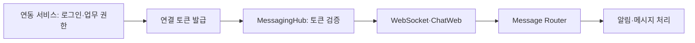

# 도메인에 의존하지 않는 채팅 플랫폼은 어떻게 만들었을까?

> [!abstract] 한 줄 정리
> 범용 플랫폼은 기능을 많이 품는 것보다, 플랫폼이 책임질 것과 연동 도메인이 책임질 것을 일관되게 분리하는 것이 중요하다. MessagingHub는 인증·도메인 데이터는 연동 측에 남기고 채팅 정책·연결·메시지 흐름에 집중한다.

> LY Corporation Tech Blog · 2026-04-01

## 핵심 내용

채팅 플랫폼을 서비스 도메인마다 새로 만들면 메시지 전송·연결·푸시·어드민 구현이 중복된다. LY MessagingHub는 주문·상담 등 도메인과 무관한 통신을 공통으로 제공하되, 누가 로그인할 수 있고 어떤 업무 권한이 있는지는 연동 서비스가 담당하도록 설계했다.

*원문을 근거로 자체 재구성한 가로형 학습 도식이다.*

연동 서비스에서 인증을 거친 사용자가 연결 토큰을 받으면 플랫폼은 토큰을 확인하고 WebSocket 연결·메시지 라우팅·알림을 관리한다. 관심사를 Connection Manager, 채팅 업무 컴포넌트, Message Router, Notification, Admin으로 나누고 이벤트로 묶으면 플랫폼 내부의 채널 변경이 연동 서비스에 덜 전파된다. 클라이언트 구현은 SDK를 앱별로 복제하는 대신 ChatWeb을 WebView·iframe으로 공유해 공통 UI와 정책의 배포를 중앙에서 처리한다.

| 경계 | 연동 도메인 책임 | 공통 플랫폼 책임 |
| --- | --- | --- |
| 사용자 자격 | 로그인·업무 권한 | 연결 토큰 검사 |
| 메시지 의미 | 채팅방 참여·업무 규칙 | 연결·라우팅·전송 |
| UI | WebView/iframe 연동 | ChatWeb 공통 배포 |
| 시나리오 버전 | 업무 흐름 정의 | 진행 중 대화의 SOFT STOP 전환 |

한 사용자가 기존 챗봇 흐름을 진행하는 동안 새 시나리오가 배포되면 중간 단계가 사라질 수 있다. 그래서 이전 시나리오를 SOFT STOP 상태로 남겨 신규 진입은 새 시나리오로 보내면서 기존 대화는 원래 흐름에서 완료하도록 했다. 서비스와 플랫폼의 권한 경계, 토큰 유효기간, 메시지의 중복·연결 해제 처리 계약이 성공 여부를 결정한다.

## 왜 읽을까

플랫폼 설계에서 가장 어려운 문제 중 하나인 “어디까지 공통화할 것인가”를 구체적인 운영 시스템으로 볼 수 있다. 특히 도메인 지식을 플랫폼에 조금씩 끌어들이는 편의가 장기적으로 범용성을 무너뜨릴 수 있다는 경계 설정이 좋다.

**프로젝트에 적용 — FutMatch**

- [ ] 채팅·알림 기능을 붙일 때 사용자 인증/권한과 메시징 기능의 책임 경계를 먼저 문서화한다.
- [ ] 채팅방 상태를 암묵적인 boolean 조합보다 명시적인 상태 전이로 모델링한다.
- [ ] 향후 다른 도메인에도 재사용할 기능이라면 특정 경기·팀 도메인 필드를 공통 메시징 모델에 직접 넣지 않는 방향을 검토한다.

---

**원문:** [도메인에 의존하지 않는 채팅 플랫폼은 어떻게 만들었을까?](https://techblog.lycorp.co.jp/ko/how-we-built-a-domain-agnostic-chat-platform)
