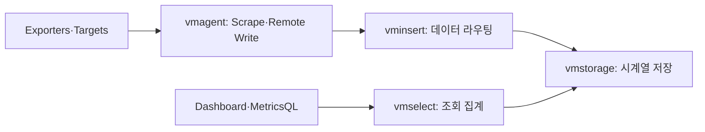

# Inside VictoriaMetrics

> [!abstract] 한 줄 정리
> VictoriaMetrics를 단순한 모니터링 저장소로 보지 않고 수집 → 라우팅 → 저장 → 조회 파이프라인으로 분해해 내부 동작을 따라간다. 메트릭 시스템도 결국 데이터 유입량·카디널리티·저장 구조·조회 비용의 균형 문제라는 걸 이해하기 좋다.

> NAVER D2 · 2026-06-02

## 핵심 내용

VictoriaMetrics는 대량의 시계열 메트릭을 수집·저장·조회하는 역할을 서로 다른 프로세스로 분리할 수 있는 구조를 가진다. NAVER D2의 발표 소개는 `vmagent → vminsert → vmstorage`라는 쓰기 경로와 `vmselect`라는 조회 경로를 따라 내부의 설계와 수집 시 좋은 패턴·나쁜 패턴을 설명한다.

*NAVER D2 발표 개요의 컴포넌트 역할을 재구성한 가로형 설명도다. 영상에서 제시한 상세 파티셔닝 알고리즘을 직접 검증한 그림은 아니다.*

vmagent는 대상 스크레이핑과 Remote Write 버퍼링·전달을 맡고, vminsert는 들어오는 시계열 샘플을 적절한 vmstorage로 라우팅한다. vmstorage는 레이블·시계열 식별자와 샘플 저장의 효율을 책임지고 vmselect는 여러 storage에서 조회 결과를 모은다. 이처럼 수집을 늘리는 정책이 storage의 카디널리티와 select의 검색 비용에 직접 영향을 주므로 '수집할 수 있다'와 '조회할 가치가 있다'를 구분해야 한다.

요청 ID처럼 값의 종류가 계속 변하는 것을 메트릭 레이블로 넣으면 시계열 조합이 급격히 증가할 수 있다. 필요한 SLI를 정의한 후 서비스·상태 코드 등 비교적 한정된 레이블만 우선 수집하고, 개별 요청 추적은 로그나 트레이스로 분리하는 전략을 검토할 수 있다. 원문의 본문은 발표 영상 안내 중심이므로 실제 vmstorage 압축률이나 조회 시간 개선 수치를 이 글의 실측 성과처럼 적지 않는다.

## 왜 읽을까

Prometheus/VictoriaMetrics 같은 도구를 설정법으로만 배우지 않고 데이터가 실제로 어느 경로를 지나가는지 이해할 수 있다. 이후 OOM, 느린 쿼리, 디스크 증가 같은 증상을 만났을 때 어느 계층부터 조사할지 판단하는 기반이 된다.

**프로젝트에 적용 — PawCycle**

- [ ] 부하 테스트에서 수집하는 메트릭마다 “어떤 운영 질문에 답하기 위한 값인가”를 연결해 본다.
- [ ] Hikari active/pending, Tomcat busy, API p95/p99처럼 현재 쓰는 지표의 레이블 카디널리티가 불필요하게 커지지 않는지 확인한다.
- [ ] 모니터링 저장 비용과 애플리케이션 성능 영향을 함께 측정해 관측 자체가 새로운 병목이 되지 않게 한다.

---

**원문:** [Inside VictoriaMetrics](https://d2.naver.com/helloworld/9290861)
