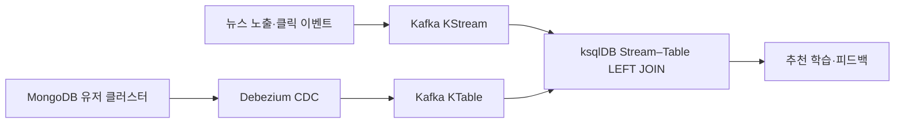

# ksqlDB 실시간 Join으로 뉴스 추천 만들기

> [!abstract] 한 줄 정리
> 초당 수만 건의 실시간 이벤트마다 원본 DB를 조회하는 대신, 변경 데이터를 스트림으로 복제하고 이벤트 스트림과 상태 테이블을 같은 키로 조인해 DB 부하를 피했다.

> 토스 기술 블로그 · 2024-09-23

## 핵심 내용

실시간 뉴스 추천에 필요한 것은 뉴스 활동 이벤트와 현재 사용자의 클러스터 정보를 같은 이벤트 처리 경로에서 연결하는 것이다. 초당 5만 건이 넘는 활동 이벤트마다 MongoDB의 사용자 상태를 조회하면 DB 읽기 부하가 급증하므로, 토스증권은 상태를 CDC로 Kafka로 복제해 이벤트 스트림과 함께 처리했다.



*원문에서 확인한 Kafka 상태 조인 구조를 가로형으로 재구성했다. 정합성에는 같은 키와 파티션 전략이 필요하다.*

Debezium이 MongoDB 사용자 클러스터 변화를 캡처하여 Kafka 토픽을 최신 상태를 보유한 KTable로 만들고, 뉴스 노출·클릭 로그는 KStream으로 처리한다. ksqlDB의 Stream–Table LEFT JOIN으로 현재 사용자 클러스터를 붙인다. 매칭 상태가 없어도 활동 이벤트 자체를 버리면 안 되므로 INNER JOIN을 피했고, 상태 미존재나 삭제 이벤트는 별도로 표현한다.

```sql
-- Join 구조를 설명하는 ksqlDB 개념 SQL (실제 토픽/스키마와 다름)
SELECT e.user_id, e.news_id, u.cluster_id
FROM news_events e
LEFT JOIN user_clusters u ON e.user_id = u.user_id
EMIT CHANGES;
```

실제 배포에서는 파티션 수와 key serialization, tombstone 처리를 별도로 확인해야 한다.

Join은 단순히 키 이름이 같다고 동작하지 않는다. ksqlDB에서 이벤트 토픽과 상태 토픽은 같은 파티션 번호·키에 위치해야 하므로 토픽 파티션 수와 파티셔닝 전략이 다르면 유저 데이터가 존재해도 Join 결과에서 찾지 못할 수 있다. `PARTITION BY`나 재파티셔닝을 통해 같은 키가 같은 파티션으로 가도록 맞춰야 하고, 파티션 수를 늘리면 로컬 RocksDB 상태의 분산·복구 비용도 함께 달라진다.

## 왜 읽을까

이벤트 처리에서 핵심은 Kafka 도입 자체가 아니라 **원본 DB에 대한 반복 조회를 줄이면서도 Join 정합성을 유지하는 방법**이다. 파티션 키를 잘못 고르면 분산 처리에서 조용히 잘못된 결과가 나온다는 점을 구체적으로 배울 수 있다.

**프로젝트에 적용 — FutMatch**

- [ ] 경기 참가·취소 이벤트와 경기/팀 상태를 조합해야 하는 실시간 기능을 목록화한다.
- [ ] 초기에는 DB 조회와 이벤트량을 계측하고, 규모가 충분히 커질 때만 CDC·Stream–Table Join을 검토한다.
- [ ] 분산 Join을 도입한다면 경기 ID/팀 ID의 파티션 키 일치와 미매칭 이벤트 보존 테스트를 작성한다.

---

**원문:** [ksqlDB 실시간 Join으로 뉴스 추천 만들기](https://toss.tech/article/ksqldb-realtime-data-2)
