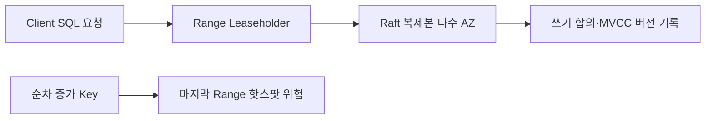

# CockroachDB in Production

> [!abstract] 한 줄 정리
> 분산 SQL 데이터베이스 선택은 SQL 호환성만으로 결정할 수 없다. 실제 워크로드의 지연 분포, 확장성, 장애 복원력, 키 분산과 복제 위치를 함께 검증해야 한다.

> 데브시스터즈 기술 블로그 · 2022-12-13

## 핵심 내용

쿠키런: 킹덤의 DB 선택에는 관계형 트랜잭션과 갑작스러운 사용자 증가에 따른 수평 확장성이 동시에 필요했다. 기존 MySQL·Couchbase 경험만으로는 분산 SQL의 비용을 추정하기 어려워 DynamoDB, Aurora와 CockroachDB를 실제 게임에 가까운 워크로드로 비교했다.

*원문에서 설명한 분산 SQL 요소를 가로형으로 단순화했다. 실제 읽기·쓰기 경로는 consistency·replica 배치에 따라 달라진다.*

CockroachDB는 키 범위를 Range로 쪼개 복제하고, 각 Range의 Leaseholder와 Raft 합의 과정을 이용해 일관된 읽기·쓰기를 제공한다. 여러 AZ에 복제본을 분산해 장애에 대비하지만 locality 설정이 없으면 특정 가용 영역에 복제본이 몰릴 수 있다. MVCC로 과거 값이 남기 때문에 업데이트가 많이 발생할수록 저장 용량과 정리 부담도 커진다.

| 검토 요소 | 선택의 장점 | 남는 위험 |
| --- | --- | --- |
| Range + Raft | 트랜잭션·복제·수평 확장 | 복제 합의와 네트워크 비용 |
| MVCC | 동시 접근 버전 관리 | 오래된 버전의 저장·GC 비용 |
| 순차 PK | 생성·정렬에 편리 | 단일 Range 쓰기 핫스팟 |
| locality 배치 | AZ 장애 복원력 | 설정 없이 복제본 편중 가능 |

벤치마크에서 CockroachDB와 Aurora의 p50은 비슷하고 CockroachDB의 p99가 더 좋았지만 이는 해당 게임 데이터·인프라에 대한 결과다. DynamoDB는 약 0.01%의 오류가 나타났으며 일반적인 제품 우열의 증거로 삼을 수 없다. 연속 증가하는 PK·타임스탬프를 쓰면 마지막 Range에 쓰기가 집중되므로 UUID나 해시 샤딩의 분산 특성과 정렬 범위 조회의 비용을 함께 고려해야 한다.

## 왜 읽을까

데이터베이스의 표면적인 API가 같아도 내부 저장·합의·복제 방식이 다르면 인덱스와 PK 설계의 판단 기준도 달라진다는 점을 배울 수 있다. 특히 성능 벤치마크와 실제 운영 실패를 함께 제시하는 것이 가치 있다.

**프로젝트에 적용 — FutMatch**

- [ ] 경기 참가·취소의 동시 요청에 필요한 트랜잭션 격리와 재시도 정책을 문서화한다.
- [ ] DB 선정 시 평균 지연뿐 아니라 p95/p99와 오류율을 함께 측정한다.
- [ ] 현재 DB의 백업·복구와 단일 인스턴스 장애 시 동작을 검증하고, 분산 DB 도입은 실제 요구가 확인될 때 판단한다.

---

**원문:** [CockroachDB in Production](https://tech.devsisters.com/posts/cockroachdb-in-production/)
