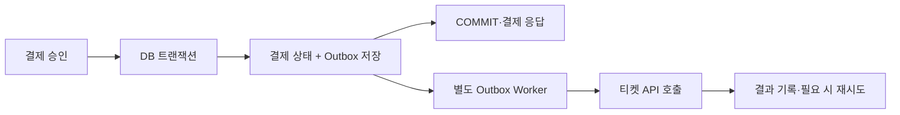

# 결제 트랜잭션의 책임 재정의: Event Driven과 Outbox 패턴 도입기

> [!abstract] 한 줄 정리
> 핵심 DB 트랜잭션 안에서 외부 API 응답을 기다리면 외부 장애가 내부 커넥션 점유와 결제 실패로 전파된다. 트랜잭션의 책임을 내부 상태와 후속 작업 기록으로 좁히고, 외부 실행은 Outbox를 통해 분리한다.

> Minseo Kim · Medium 개인 개발 블로그 · 2026-01-26

## 핵심 내용

외부 티켓 발급 API를 결제 승인과 같은 DB 트랜잭션 안에서 호출하면 외부 서비스의 지연이 결제 API 응답시간과 DB 커넥션 점유에 전파된다. 단순히 네트워크 타임아웃을 짧게 하더라도 완전히 장애가 난 외부 API를 기다리는 결제 트랜잭션의 책임 경계는 그대로 남는다.



*원문의 결제와 발급 책임 분리를 가로형으로 재구성했다. 외부 티켓 API는 같은 DB 트랜잭션에 참여하지 않는다.*

Outbox 방식은 결제 성공 상태와 티켓 발급 의도(이벤트)를 하나의 로컬 DB 트랜잭션에 기록하고 커밋한다. 이후 별도 워커가 미처리 Outbox를 읽어 외부 티켓 서버에 요청하고 결과를 기록한다. 이때 결제 HTTP 응답은 티켓 발급의 완료를 뜻하지 않으므로 상태를 `PAYMENT_COMPLETED`, `TICKET_PENDING`, `TICKET_ISSUED`, `TICKET_FAILED`처럼 구분할 수 있다. 이러한 이름은 학습용 예시이며 실제 서비스 도메인 상태와는 다를 수 있다.

```sql
-- 같은 로컬 트랜잭션에 두 쓰기를 포함하는 개념 예시
BEGIN;
UPDATE payments SET status = 'COMPLETED' WHERE id = :paymentId;
INSERT INTO outbox(event_id, aggregate_id, event_type)
VALUES (:eventId, :paymentId, 'IssueTicket');
COMMIT;
```

실제 운영에는 중복 이벤트 제약·워커 선점·재시도/복구 상태 계약이 추가되어야 한다.

이 구조는 외부 장애를 결제의 원자적 커밋에서 제거하지만 티켓 발급은 나중에 완료될 수 있다는 최종 일관성의 비용을 만든다. 워커가 발급 요청을 성공시킨 직후 처리 완료 표시 전에 죽으면 같은 Outbox를 재처리할 수 있으므로 이벤트·발급 요청 식별자의 멱등성도 필요하다. 원문은 정량적인 성능 개선값을 공개하지 않으므로 성공률 향상을 숫자로 표현해서는 안 된다.

## 왜 읽을까

트랜잭션의 원자성을 ‘외부 서비스 호출까지 한꺼번에 묶는 것’과 혼동하면 생기는 문제를 이해할 수 있다. 단순 타임아웃 튜닝보다 실패 경계를 바꾸는 설계가 중요한 상황을 보여준다.

**프로젝트에 적용 — DevPedia**

- [ ] 모집 지원 승인 로직에서 DB 상태 변경과 외부 알림 전송이 같은 트랜잭션에 있는지 확인한다.
- [ ] 외부 알림을 추가한다면 승인 결과는 DB에 먼저 확정하고, 알림 실패는 별도 후속 처리 상태로 관리할지 설계한다.
- [ ] 중복 처리·재시도 시 동일 알림이 여러 번 전송될 위험을 테스트 시나리오로 정리한다.

---

**원문:** [결제 트랜잭션의 책임 재정의: Event Driven과 Outbox 패턴 도입기](https://medium.com/@minseo-kim/%EA%B2%B0%EC%A0%9C-%ED%8A%B8%EB%9E%9C%EC%9E%AD%EC%85%98%EC%9D%98-%EC%95%88%EC%A0%95%EC%84%B1%EC%9D%84-%EB%86%92%EC%9D%B4%EB%8A%94-%EC%9E%A5%EC%95%A0-%EA%B2%A9%EB%A6%AC-%EC%A0%84%EB%9E%B5-f14cf9b45948)
