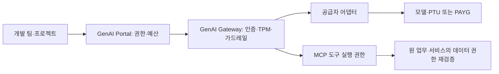

# 서비스 개발에 집중할 수 있는 AI 플랫폼 만들기

> [!abstract] 한 줄 정리
> AI 서비스 운영에는 모델 호출 코드뿐 아니라 권한, 데이터 등급, 사용량, 비용과 추적 체계가 필요하다. Portal에서 정한 사용 조건을 Gateway가 실제 요청마다 강제하도록 설계했다.

> 토스 기술 블로그 · 토스 AI Platform 팀 · 2026-10-13

## 핵심 내용

기업 내부에서 여러 AI 모델과 MCP 도구를 쓰려면 호출 코드를 통일하는 일보다 **누가 어떤 민감도 데이터로 어느 모델·도구를 실행할 수 있는지** 통제하는 일이 먼저다. 토스 AI Platform은 GenAI Portal과 GenAI Gateway로 권한·예산·보안·실행 경계를 나눴다.

*기사에 소개된 책임 분리를 바탕으로 자체 재구성한 가로형 경계도다. 모델 사용 권한과 도구의 최종 업무 권한은 다르다.*

Portal은 프로젝트·사용 신청·예산을 관리하고 Gateway는 실제 호출마다 API Key, 모델 권한, 요청 제한, 가드레일을 확인한다. 공급자별 인증과 요청·응답 차이는 어댑터가 흡수한다. 데이터 민감도는 L1부터 L4까지 별도로 관리하고, 모델 호출 자격이 있다는 사실만으로 연결된 MCP 도구가 임의의 업무 데이터를 읽도록 허용하지 않는다. 도구에서 최종적으로 수행하는 업무 권한 검사는 원 소유 서비스가 다시 판단해야 한다.

| 정책 | 관리 대상 | 구분해야 할 위험 |
| --- | --- | --- |
| 데이터 등급 L1–L4 | 호출 가능한 모델과 정보 종류 | 민감한 원문이 로그에 남지 않도록 처리 |
| 모델 호출 권한 | 프로젝트·API Key·모델 | MCP 도구 데이터 권한과 별도 |
| TPM | 순간 트래픽/출력 예약 | 실행 중 요청도 예상 토큰 차감 |
| 월 예산 | 누적 사용 비용 | 트래픽 제한과 별개 |
| PTU→PAYG | 같은 모델의 용량 폴백 | 모델 변경은 품질 검증 필요 |

비용 보호에는 분당 처리량(TPM)과 월 예산의 경계를 분리했다. 스트리밍 중이거나 완료되지 않은 호출도 예상 출력 토큰을 예약해 한도를 계산하고, 완료 시 실제 사용량으로 보정한다. PTU 기반 사전 확보 용량이 부족할 때 PAYG로 같은 모델 요청을 보내는 전략은 용량 확보에 도움이 되지만 다른 모델로 변경하려면 결과 품질을 따로 검증해야 한다. 프롬프트 공격 차단과 개인정보 마스킹, Langfuse 추적 식별자 연결도 함께 관리한다.

## 왜 읽을까

AI 서비스의 위험은 프롬프트 품질만이 아니다. 요청마다 권한을 검증하고, 민감한 로그를 보호하며, 동시 요청량을 정확히 계산하는 운영 설계가 필요함을 구체적으로 보여준다.

**프로젝트에 적용 — PawCycle**

- [ ] AI 기능에 입력되는 데이터의 민감도와 외부 모델 전송 가능 범위를 정의한다.
- [ ] 모델 호출을 하나의 경계로 모아 API 키·타임아웃·호출량·비용을 관찰한다.
- [ ] 개인정보를 기록하지 않으면서 지연·오류·호출 단계를 추적하는 로그 기준을 정한다.
- [ ] 완료된 요청만 세는 사용량 제한이 동시 요청에서 안전한지 검토한다.

---

**원문:** [서비스 개발에 집중할 수 있는 AI 플랫폼 만들기](https://toss.tech/article/ai-platform-foundation)
