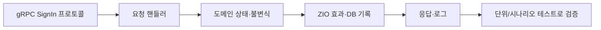

# 새로운 팀의 코드베이스 적응기: 내 코드로 만들어가는 과정

> [!abstract] 한 줄 정리
> 낯선 언어와 아키텍처를 한 번에 정복하려 하지 않고, 실행 가능한 개발 환경과 핵심 요청 흐름 하나부터 파악한 뒤 작은 변경을 반복해 코드베이스 전체의 맥락을 익힌 경험이다.

> 데브시스터즈 DEVTECH · 주윤아 · 2025-03-05

## 핵심 내용

C# 서버 개발 경험이 있는 엔지니어가 Scala·ZIO·DDD·헥사고날 아키텍처의 실서비스 코드를 인수하면 언어 문법만 새로 배우는 것으로는 충분하지 않다. 실행에 성공한 코드가 실제 요청을 어디서 받아 어떤 상태를 변경하고 무엇을 반환하는지 알아야 안전하게 기능을 추가할 수 있다.

*원문의 온보딩 순서를 바탕으로 만든 수직 슬라이스 개념도이며 실제 Scala 클래스 배치를 그대로 복제한 것은 아니다.*

적응 과정에서는 언어 문법과 함수형 효과 모델을 먼저 학습한 뒤 서버 컴파일·실행을 성공시키고, 구체적인 `SignIn` gRPC 프로토콜에서 요청을 따라갔다. 로그인 보상·운영 로그 같은 작은 변경으로 테스트와 배포 경로를 익힌 다음 광고 기능과 이벤트처럼 더 큰 기능으로 범위를 확장했다. 코드가 여러 계층으로 나뉘어 있더라도 프로토콜 진입점부터 도메인 규칙, 영속성·외부 효과 경계까지 하나의 수직 슬라이스로 추적해야 한다.

초기 몇 주에는 코드를 수정할 수 있어도 왜 그 위치에 배치하는지 설명하기 어려웠다. 약 6개월 뒤에는 전체 코드 흐름과 아키텍처의 경계를 설명하고 팀 가이드 문서를 작성할 정도로 적응했다고 회고한다. 특정 언어나 프레임워크의 속성보다 **작은 실무 과제를 통해 요청 흐름을 반복 추적하고 변경 근거를 기록한 학습 방식**이 중심이다.

## 왜 읽을까

기존 프로젝트를 내 것으로 만들 때 어떤 순서로 읽고 수정해야 하는지 구체적인 학습 경로를 제시한다. 문법을 전부 암기한 뒤 시작하는 방식도, 이해 없이 기능만 복사하는 방식도 아닌 중간 경로를 보여준다.

**프로젝트에 적용 — PawCycle**

- [ ] 로컬에서 백엔드를 실행하고 핵심 API 하나의 요청→서비스→저장소 흐름을 디버거로 추적한다.
- [ ] 해당 흐름의 도메인 규칙·부수 효과·트랜잭션 경계를 자신의 말로 기록한다.
- [ ] 작은 테스트 보강 또는 버그 수정을 직접 완료하고 변경 영향 범위를 검증한다.

---

**원문:** [새로운 팀의 코드베이스 적응기: 내 코드로 만들어가는 과정](https://tech.devsisters.com/posts/adapt-to-new-codebase/)
