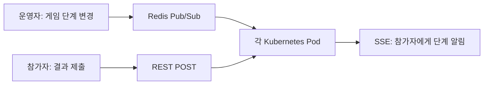

# AI에게 만드는 법 대신 실패하는 법을 묻다: 포토그래퍼의 수천 명 동시 접속 게임 만들기

> [!abstract] 한 줄 정리
> 대규모 동시 접속 시스템에서 기술 선택은 유행하는 프로토콜보다 배포 제약과 실패 조건을 먼저 따져야 한다. AI에는 정답 구현보다 '어떻게 망가질 수 있는가'를 물어 설계 판단의 재료를 모았다.

> 우아한형제들 기술블로그 · 장진솔 · 2026-08-28

## 핵심 내용

3주 안에 수천 명이 참여할 행사 게임을 만들어야 했던 두 명의 비전문 개발자는 게임 코드를 만들기 전에 시스템이 어떤 상황에서 실패할지부터 정의했다. 사내 배포 환경에서는 WebSocket을 사용하기 어려웠고, 여러 Kubernetes Pod가 각각 다른 사용자 연결을 관리하므로 특정 Pod의 메모리 상태만 갱신해서는 전체 사용자에게 동일한 게임 단계를 보여줄 수 없었다.

*원문에서 확인한 역할 분리를 가로형으로 자체 재구성한 도식이다. Redis Pub/Sub는 영속 큐가 아니므로 재접속 시 상태 복구 계약을 별도로 검증해야 한다.*

게임 단계의 서버→클라이언트 전달에는 SSE를, 사용자의 결과 제출에는 REST POST를 사용하고, Pod 사이의 단계 동기화에는 Redis Pub/Sub를 두었다. SSE는 단방향 알림에 적합하지만 클라이언트가 게임 결과를 제출하는 경로까지 처리하지 않으므로 POST와 분리할 필요가 있다. Redis Pub/Sub 역시 메시지 영속화나 재전송을 보장하지 않기 때문에 접속이 끊긴 사용자가 다시 돌아왔을 때 현재 단계를 재조회하는 경로를 생각해야 한다.

| 실패 가정 | 검증할 동작 | 별도 주의점 |
| --- | --- | --- |
| SSE 연결 종료 | 재접속 뒤 현재 단계 복구 | 이벤트 유실 가능성 |
| 여러 Pod에 분산된 사용자 | 같은 단계가 전파되는지 | 로컬 메모리만 갱신하면 불일치 |
| 동시에 제출된 결과 | 중복 제출·경쟁 처리 | 멱등성 및 원자성 요구 |
| 수천 봇 동시 접속 | 게임 서버와 부하 발생기 양쪽 관측 | 로컬 Wi-Fi 병목을 서버 병목으로 오인 금지 |

AI에게 동시 제출, 접속 폭주, 서버 재시작, 중복 탭과 같은 실패 시나리오를 먼저 질문했고, 재접속 간격에 무작위 지연을 주는 방안도 검토했다. 로컬 맥북에서 봇 수천 개를 실행했을 때 게임 서버가 아닌 Wi-Fi가 먼저 한계에 도달하자 Kubernetes Job으로 부하 생성기를 옮겼다. 이후 예상 인원의 두 배 규모로 새로고침·탭 종료·연결 단절을 섞은 테스트를 수행했으며, 테스트 발신 측 자원도 성능 실험의 일부라는 사실을 확인했다.

## 왜 읽을까

실시간 요구사항이 있다고 해서 반드시 양방향 WebSocket을 써야 하는 것은 아니다. 통신 방향과 상태 공유 책임을 나누면 더 단순한 설계를 선택할 수 있으며, 부하 테스트 도구 자체가 병목이 되는 함정도 확인할 수 있다.

**프로젝트에 적용 — FutMatch**

- [ ] 경기 상태 변경이 서버에서 사용자에게만 전달되면 되는지, 실제 양방향 통신이 필요한지 요구사항을 먼저 분리한다.
- [ ] 서버 인스턴스가 여러 개인 경우 상태 변경이 모든 연결에 전달되는지 확인한다.
- [ ] 재접속·중복 요청·동시 참가 상황을 부하 테스트에 포함하고 테스트 발신 측 한계도 별도로 측정한다.

---

**원문:** [AI에게 만드는 법 대신 실패하는 법을 묻다: 포토그래퍼의 수천 명 동시 접속 게임 만들기](https://techblog.woowahan.com/27268/)
