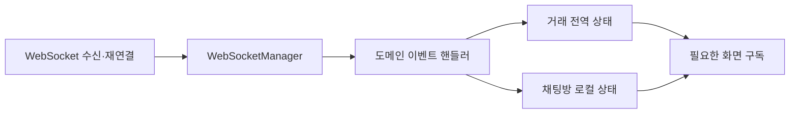

# 아무도 손대지 못했던 채팅, 뜯어고치기까지 — PART1

> [!abstract] 한 줄 정리
> 100개 넘는 파일이 참조하는 전역 상태와 거대한 WebSocket 핸들러를 한 번에 교체하지 않았다. 어댑터와 기능 플래그로 변경을 작은 PR로 나누고 상태 생명주기 및 이벤트 처리 책임을 재설계했다.

> 스터닝 개발팀 · 이희찬 · 2026-05-07

## 핵심 내용

- **문제:** WebSocket 이벤트를 수백 줄짜리 단일 핸들러가 처리하고, 채팅·거래·메시지·스크롤 상태가 Redux에 섞여 리렌더링과 실시간 동기화 오류가 발생했다. ChatList는 880줄, ChatPanel은 937줄에 달했다. - **접근:** `useDeal` 같은 공통 훅으로 기존 Redux 소비 지점을 먼저 감싼 뒤 기능 플래그로 Zustand 전환 경로를 제어했다. 각 PR을 독립적으로 리뷰·배포·롤백할 수 있게 했다. - **구조:** 화면 밖에서도 필요한 거래 상태는 전역에, 채팅방·메시지·스크롤·전송 파일은 화면 생명주기를 따르는 로컬 상태에 두었다. Provider가 사라질 때 상태도 정리되도록 했다.

- **분리:** WebSocketManager는 연결·재연결·파싱·이벤트 발행만, 도메인별 핸들러는 각 스토어 갱신만 담당하도록 분리했다. Layout/State/Data/Domain UI도 책임별로 나눴다. - **주의점:** 상태 관리 라이브러리 변경 자체가 해결책은 아니다. 기존 소비자와 이벤트 처리의 결합을 먼저 낮춰야 무중단 점진 전환이 가능하다.

이 사례에서 분리해야 할 것은 Redux와 Zustand의 기능 비교가 아니라 상태가 살아 있어야 하는 기간과 이벤트를 처리할 책임이다. 거래 정보는 채팅 화면이 사라진 뒤에도 유지되어야 하지만, 특정 방의 스크롤 위치와 전송 파일은 화면을 떠날 때 정리하는 편이 자연스럽다. 이벤트 연결을 담당하는 코드가 화면 상태까지 직접 수정하면 연결 재시도와 UI 변경의 영향 범위가 함께 커진다.

*자체 재구성. 연결 생명주기와 도메인·화면 상태의 소유권을 나눈다.*

Zustand로 한꺼번에 이동하지 않고 `useDeal`과 기능 플래그를 중간 경계로 둔 이유는 이전 API 사용자를 즉시 모두 바꾸지 않아도 배포와 롤백을 분리할 수 있기 때문이다. 검증 시에는 중복 WebSocket 이벤트, 화면 전환 후 오래된 상태, 재연결 이후 중복 구독을 함께 확인해야 한다.

## 왜 읽을까

리팩터링의 성공 조건을 ‘새 라이브러리 적용’이 아니라 ‘변경을 안전하게 나눌 수 있는 구조’로 보는 글이다. 실시간 메시징의 전송 책임과 비즈니스 이벤트 처리 책임을 어디서 분리할지 판단하는 데 유용하다.

**프로젝트에 적용 — FutMatch**

- [ ] 경기 참가 상태가 실시간 갱신되는 화면을 구현한다면 연결 관리와 참가 상태 처리 로직을 분리한다.
- [ ] 화면을 벗어나면 폐기해야 하는 상태와 앱 전역에서 유지할 상태를 명시한다.
- [ ] 실시간 기능을 변경할 때 기능 플래그 또는 호환 계층으로 단계별 전환·롤백 가능성을 검토한다.

---

**원문:** [아무도 손대지 못했던 채팅, 뜯어고치기까지 — PART1](https://medium.com/@team_stunning/%EC%95%84%EB%AC%B4%EB%8F%84-%EC%86%90%EB%8C%80%EC%A7%80-%EB%AA%BB%ED%96%88%EB%8D%98-%EC%B1%84%ED%8C%85-%EB%9C%AF%EC%96%B4%EA%B3%A0%EC%B9%98%EA%B8%B0%EA%B9%8C%EC%A7%80-part1-b9340d2bb59c)
