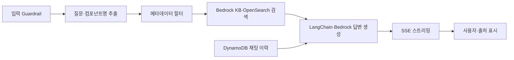

# 우아한공방의 새로운 동료, 시스템 맥락을 가진 챗봇서비스 개발기(feat. RAG)

> [!abstract] 한 줄 정리
> 디자인시스템 문서·코드·이슈 히스토리를 RAG 챗봇으로 연결하면서 단순 의미 검색의 오참조를 메타데이터 필터로 줄였다. 가드레일의 출력 검사 때문에 정상 응답과 SSE 스트리밍이 지연된 시행착오까지 설명한다.

> 우아한형제들 기술블로그 · 권현아, 성민제 · 2026-05-22

## 한눈에 보기

RAG 챗봇은 검색 가능한 문서를 많이 연결하기만 하면 좋은 답변을 제공하는 것이 아니다. 우아한형제들은 디자인 시스템 문서·코드·문의 히스토리를 Bedrock Knowledge Bases와 OpenSearch Serverless로 연결했지만, 서로 비슷한 컴포넌트 이름이 검색에 섞이는 문제가 있었다. 검색 메타데이터의 의미와 Guardrail의 적용 시점이 답변 정확도뿐 아니라 실시간 스트리밍 경험을 좌우했다.

*원문을 토대로 자체 재구성한 학습용 흐름도다.*

버튼 검색에서는 `Button`과 `IconButton`이 혼동될 수 있어 컴포넌트명과 구분자를 포함한 메타데이터를 사용해 필터링했다. 검색 결과 수(topK)는 특정 컴포넌트를 찾을 때와 전반적인 정책·히스토리를 물을 때 달라져야 불필요한 문서가 줄어든다. 출력 Guardrail은 정상적인 히스토리 설명을 차단하거나 SSE의 chunk를 지연시켜 입력 중심 검사와 비동기 스트리밍 처리를 검토하게 만들었다.

## 핵심 내용

### 배경·문제

**문제:** 문서·디자인 가이드·코드·지원 채널 이력이 흩어져 같은 질문이 반복됐다. MCP만으로는 비개발 직군의 진입 장벽과 서비스 수준의 응답 품질·권한 통제가 해결되지 않았다.

### 접근과 구현 과정

**구조:** 웹 UI·API 서버, Bedrock Knowledge Bases와 OpenSearch Serverless 기반 검색, DynamoDB 채팅 히스토리, LangChain 체인, SSE 스트리밍을 조합했다.

**접근:** Button과 IconButton이 함께 검색되는 문제를 줄이기 위해 질문에서 컴포넌트명을 추출하고 `|FilledButton|`처럼 구분자를 포함한 메타데이터로 검색을 필터링했다.

### 검증 결과와 한계

**트레이드오프:** 특정 컴포넌트 질문에는 작은 topK, 정책·히스토리 질문에는 더 넓은 topK가 적합했다. 검색 문서 수를 늘리면 토큰 비용과 무관한 문서 혼입 위험도 커진다.

**시행착오:** Bedrock Guardrail이 입력뿐 아니라 출력까지 검사하면서 정상적인 히스토리 설명을 차단하고 SSE chunk를 지연시켰다. 입력 중심 검사와 `streamProcessingMode: 'async'` 설정으로 조정했으며 SDK 직접 호출이 필요했다.

### 주요 비교 및 검증 기준

| 현상 | 원인 | 대응·남는 제약 |
| --- | --- | --- |
| Button·IconButton 혼입 | 이름의 부분 일치와 의미적 검색 | 컴포넌트명 구분자·메타데이터 필터 |
| 불필요한 문서 포함 | 모든 질문에 동일한 topK 사용 | 질문 유형별 검색 범위 조절 |
| 정상 답변 차단 | Guardrail 출력 측 오탐 | 입력 측 검사 중심으로 정책 재설정 |
| SSE 응답 지연 | 출력 검사로 chunk 버퍼링 | `streamProcessingMode: async` 검토·SDK 직접 호출 |

*출력 검사 완화는 보안·정책 검증 범위의 변경이므로 정답률과 함께 위험도 별도로 검증해야 한다.*

## 왜 읽을까

RAG에서 검색 정확도와 서비스 정책, 스트리밍 사용자 경험이 서로 충돌할 수 있다는 점을 보여준다. 프롬프트만 수정하지 않고 메타데이터 구조와 안전 정책 적용 지점을 바꾼 판단을 배울 수 있다.

**프로젝트에 적용 — PawCycle**

- [ ] AI 기반 코드·설계 설명 기능을 검토한다면 답변에 참조한 문서의 출처와 버전을 남긴다.
- [ ] 질문 유형에 따라 검색 범위를 제한하고 잘못된 문서가 섞이는 사례를 테스트한다.
- [ ] 스트리밍 응답에 가드레일을 적용할 경우 첫 토큰 지연과 정상 응답 차단 여부를 함께 측정한다.

---

**원문:** [우아한공방의 새로운 동료, 시스템 맥락을 가진 챗봇서비스 개발기(feat. RAG)](https://techblog.woowahan.com/26319/)
