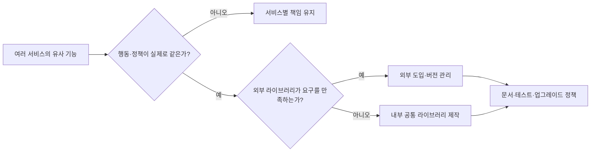

# 우리는 왜 공통 라이브러리를 만들기 시작했나

> [!abstract] 한 줄 정리
> 공통 라이브러리는 중복을 줄이지만 새로운 유지보수 책임을 만든다. 재사용보다 신뢰할 수 있는 표준과 검증 절차가 중요하다.

> 컬리 기술 블로그 · 임진호 · 2022-01-04

## 한눈에 보기

코드 중복이 발견됐다고 해서 즉시 공통 라이브러리를 만들면 유지보수 책임과 버전 호환성 문제가 새로 생길 수 있다. 컬리는 비슷한 기능을 서비스마다 별도로 구현하는 비용을 겪으면서 외부 공개 라이브러리 채택과 내부 제작을 선택적으로 비교했다. 공통화의 목적은 코드를 한곳에 모으는 것이 아니라 안정적으로 변경·검증하고 신뢰할 수 있는 기본 구성을 제공하는 데 있다.

*원문을 토대로 자체 재구성한 학습용 흐름도다.*

재사용의 단위는 이름이 비슷한 코드보다 함께 바뀌어야 하는 정책과 계약으로 정해야 한다. 외부 라이브러리는 도입 속도가 빠르지만 릴리스·지원 정책에 의존하고, 내부 라이브러리는 조직 요구를 반영하기 쉽지만 수정·리뷰·배포의 책임이 늘어난다. 원문은 `react-boiler-plate`를 세 프로젝트에 적용하며 문서와 테스트, 리뷰를 신뢰의 기준으로 삼았다.

## 핵심 내용

### 배경·문제

**문제:** 여러 물류 서비스가 비슷한 기능을 개별 구현해 운영 방식과 수정 책임이 분산됐다.

### 접근과 구현 과정

**트레이드오프:** 외부 라이브러리는 빠르게 도입할 수 있지만 버전·지원 중단 위험이 있다. 내부 제작은 정책에 맞게 설계할 수 있지만 지속적인 관리 책임이 생긴다.

**접근:** react-boiler-plate를 제작해 신규 프로젝트 3개에 적용했고, 다른 공통 기능은 외부 도입과 자체 제작을 선택적으로 판단했다.

### 검증 결과와 한계

**구조:** 코드베이스 신뢰를 위한 기준으로 문서화, 코드 리뷰, 테스트 스위트를 정했다.

### 주요 비교 및 검증 기준

| 선택 | 장점 | 감수할 위험 |
| --- | --- | --- |
| 서비스별 구현 유지 | 서로 다른 도메인 변경 격리 | 중복·일관성 부족 |
| 외부 공개 라이브러리 | 빠른 도입, 검증된 생태계 | 유지보수 종료·버전 호환성 |
| 내부 공통 라이브러리 | 조직 정책·표준 반영 | 릴리스 책임·하위 호환·테스트 비용 |
| 공통 템플릿 | 새 프로젝트 시작 기준 통일 | 획일적인 선택이 필요한 경우까지 강제될 수 있음 |

*실제 공통화 효과를 정량적인 유지보수 비용 절감으로 증명한 글은 아니므로 측정되지 않은 수치를 만들지 않는다.*

## 왜 읽을까

재사용 코드의 편리함뿐 아니라 추상화 비용과 관리 책임까지 함께 평가하는 설계 관점을 얻을 수 있다.

**프로젝트에 적용 — DevPedia**

- [ ] 중복 코드를 찾아 실제로 동일한 비즈니스 규칙인지 확인한다.
- [ ] 공통화 후보의 변경 주기와 책임 주체를 비교한다.
- [ ] 공통 유틸의 계약과 예외 조건을 테스트로 남긴다.

---

**원문:** [우리는 왜 공통 라이브러리를 만들기 시작했나](https://helloworld.kurly.com/blog/why-we-make-common-library/)
