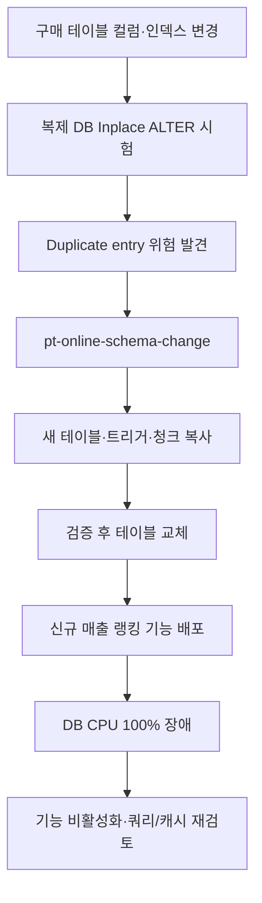

# MySQL online alter부터 CPU 100% 장애까지

> [!abstract] 한 줄 정리
> 운영 중 스키마 변경을 안전하게 마쳤더라도 새 기능의 쿼리·캐시 접근 패턴이 실제 트래픽에서 DB CPU를 고갈시킬 수 있다. DDL 검증과 기능 배포 검증을 별도 위험으로 관리해야 한다.

> 데브시스터즈 기술 블로그 · 황재영 · 2023-09-05

## 한눈에 보기

운영 스키마 변경에서 잠금을 줄이는 방법을 적용하더라도 새 기능의 운영 안전성까지 보장되는 것은 아니다. 데브시스터즈는 Inplace ALTER를 복제 DB에서 시험하다 Duplicate entry를 확인한 뒤 Percona 온라인 스키마 변경 도구로 우회했다. 테이블 교체 자체는 성공했지만 이후 새 랭킹 기능의 쿼리·캐시 접근이 운영 CPU를 100%로 올린 별도 장애가 발생했다.

*원문을 토대로 자체 재구성한 학습용 흐름도다.*

`pt-online-schema-change`는 변경할 구조의 새 테이블을 만들고 기존 테이블의 변경을 트리거로 동기화하면서 데이터를 여러 청크로 복사한 뒤 이름을 교체한다. 청크를 크게 하면 속도가 빨라질 수 있지만 복제 환경의 CPU와 잠금 위험을 높이므로 측정 후 정해야 한다. DDL 결과의 성공과 새로운 비즈니스 조회 패턴이 만드는 DB 부하의 성공은 다른 검증 게이트다.

## 핵심 내용

### 배경·문제

**문제:** 구매 시점 컬럼과 인덱스를 추가해야 했지만 구매 테이블은 서비스 핵심 경로였고 일반 ALTER의 잠금·작업 시간을 감당하기 어려웠다.

### 접근과 구현 과정

**접근:** Inplace ALTER가 복제 DB 테스트에서 간헐적인 Duplicate entry 오류를 보여 포기했다. Percona `pt-online-schema-change`의 신규 테이블·트리거·청크 복사·체크섬·테이블 교체 방식으로 전환했다.

**수치:** 운영 복제본에서 청크 250은 CPU 약 45%로 안정적이었고 청크 500은 초기에 약 80%까지 상승했다. 운영 DB의 평소 CPU 약 20%와 작업 중 70% 이하 목표를 고려해 청크 250을 선택했다.

### 검증 결과와 한계

**장애:** 스키마 변경은 성공했지만 신규 매출 랭킹 기능 배포 후 DB CPU가 100%에 도달해 게임 접속에 문제가 생겼다. 기능을 비활성화해 복구한 뒤 쿼리와 캐시 사용 패턴을 원인으로 분석했다.

**트레이드오프:** `(product_id, purchase_dt)` 복합 인덱스는 복제 DB 실험에서 약 10% 개선에 그쳐 추가 비용 대비 이득이 작다고 판단해 채택하지 않았다.

### 주요 비교 및 검증 기준

| 검증 대상 | 관찰 수치 또는 사실 | 판단 |
| --- | --- | --- |
| Inplace ALTER | 복제 DB에서 간헐적 Duplicate entry | 직접 방식 포기 |
| 청크 250 | CPU 약 45% | 운영 적용 후보 |
| 청크 500 | 초기 CPU 약 80% | 운영 CPU 70% 이하 목표에 부적합 |
| 추가 복합 인덱스 | 실험상 약 10% 개선 | 유지 비용 대비 효익 부족으로 제외 |
| 신규 랭킹 서비스 | 배포 후 DB CPU 100% | 쿼리·캐시 접근을 재검토하고 기능 중단 |

*스키마 변경 절차가 통과했다고 신규 조회 기능까지 안정적이라는 의미는 아니다.*

## 왜 읽을까

온라인 DDL의 성공과 서비스 기능의 성능 안전성은 별개라는 점을 보여주는 장애 회고다. 복제 환경에서 청크 크기를 측정하고, 배포 뒤 장애를 일으킨 쿼리와 캐시 접근 패턴까지 재검토하는 실제 의사결정을 배울 수 있다.

**프로젝트에 적용 — PawCycle**

- [ ] 운영 스키마 변경을 연습할 때 복제·백업과 롤백 경로를 준비하고 데이터 크기별 잠금·CPU·소요 시간을 측정한다.
- [ ] 신규 조회 기능을 배포하기 전 예상 호출 빈도와 캐시 갱신·미스 패턴을 부하 테스트로 검증한다.
- [ ] 비상시 기능을 중단할 수 있는 설정과 복구 절차를 배포 체크리스트에 포함한다.

---

**원문:** [MySQL online alter부터 CPU 100% 장애까지](https://tech.devsisters.com/posts/cro-mysql-online-alter/)
