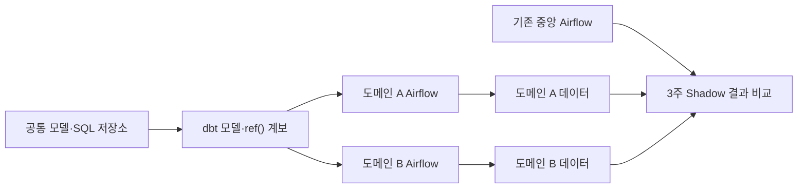

# 실행은 도메인별로, 문맥은 한 레포에

> [!abstract] 한 줄 정리
> 공유 Airflow 클러스터의 병목은 코드 정리만으로 해결되지 않았다. 실행 환경은 도메인별로 분리하되 정의와 의존성은 같은 저장소에서 선언하고, 기존 파이프라인을 병행 검증하며 점진적으로 이관했다.

> 토스 기술 블로그 · 김문수 · 2026-10-16

## 핵심 내용

- **문제:** 중앙 DW Airflow에 400개 넘는 DAG가 모여 한 도메인의 배치가 다른 도메인까지 지연시켰고, 테이블의 생성 주체·품질 규칙·SQL·의존성이 여러 시스템에 흩어져 있었다. - **접근:** Strangler Fig 방식으로 기존 파이프라인 옆에 도메인별 Airflow와 dbt 기반 새 플랫폼을 구축했다. 3주 동안 기존과 새 파이프라인이 같은 데이터를 각각 만들도록 하고 결과를 비교했다. - **트레이드오프:** 첫 전환은 기존 시스템의 다운스트림 의존성 준비가 부족해 같은 날 되돌렸다가 다음 주 다시 병합했다. Spark와 Jenkins 잡은 즉시 교체하지 않고 기존 방식과 연동해 동시 운영 기간을 줄였다.

- **구조:** 실행 클러스터는 도메인별로 분리하되 코드는 단일 저장소에 두고, `ref()`와 모델·source YAML에 테이블 의존성, 생성 주체, 설명, 테스트를 선언했다. CI는 dbt compile, DAG import, `LIMIT 0` 쿼리로 검증했다. - **수치:** 광고 도메인 DAG 코드 2,794→100줄, 수동 의존성 연결 `>>` 180→0줄, 파이프라인 시간 4시간→2시간 30분으로 감소했다.

배치 파이프라인의 실행 인프라를 도메인별로 분리하는 선택과 코드 저장소를 모으는 선택은 서로 모순되지 않는다. 실행 시에는 다른 도메인의 CPU·스케줄러 부하를 격리하고, 정의와 검증 시에는 한 저장소에서 `dbt ref()` 의존성·모델·소스를 추적하기 때문이다. 기존 400개 이상의 DAG를 일괄 교체하지 않고 새 Airflow를 병행 운영한 것은 숨은 다운스트림 의존성을 발견할 시간을 확보하려는 단계적 이행이었다.

*자체 재구성. 실행 단위 격리와 메타데이터 통합을 구별한다.*

첫 전환 당일 되돌린 이력에서 중요한 것은 실패가 아니라 의존성 준비가 충분한지 **전환 게이트**를 세울 필요가 있었다는 점이다. CI의 컴파일·DAG Import·`LIMIT 0` 검증은 초기 안전망이지만 실제 데이터 정합성과 처리 시간까지 대신 검증하지는 못한다.

## 왜 읽을까

점진적 마이그레이션에서 중요한 것은 새 도구의 기능보다 기존 소비자를 끊지 않고 동일한 결과를 검증하는 절차라는 점을 배울 수 있다. 코드와 메타데이터를 같은 변경 단위에 두어 사람이든 에이전트든 데이터 계보를 파악하기 쉽게 만드는 설계도 흥미롭다.

**프로젝트에 적용 — PawCycle**

- [ ] 대량 데이터 생성·집계 기능 중 하나를 골라 입력 테이블, 산출물, 실행 주기, 후속 소비자를 명시한다.
- [ ] 집계 로직을 개선할 때 기존·신규 결과를 격리 환경에서 병행 생성하고 행 수와 핵심 집계값을 비교한다.
- [ ] 전환 PR에는 되돌리는 조건과 하위 의존성의 변경 여부를 기록한다.

---

**원문:** [실행은 도메인별로, 문맥은 한 레포에](https://toss.tech/article/53879)
