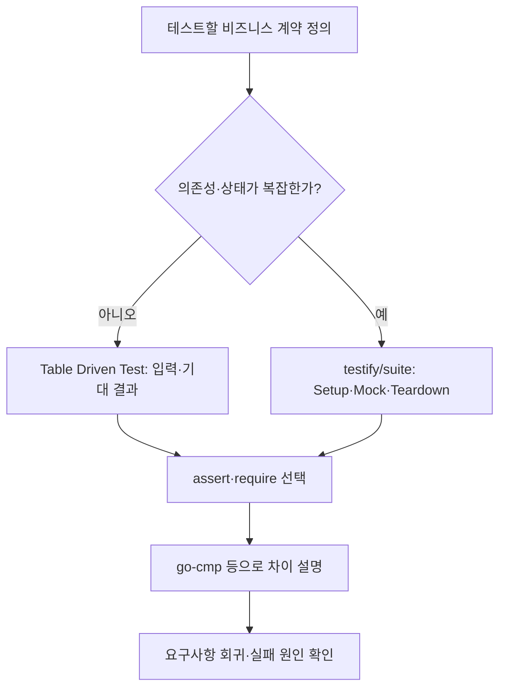

# 우리가 테스트를 하는 이유. 근데 이제 Golang을 곁들인

> [!abstract] 한 줄 정리
> 테스트의 목적은 코드 줄 수를 채우는 것이 아니라 요구사항의 불확실성과 회귀 위험을 줄이는 피드백 루프를 만드는 데 있다. 검증 대상의 복잡도에 맞춰 테스트 구조와 비교 도구를 달리해야 한다.

> 뱅크샐러드 기술 블로그 · 김한수 · 2025-12-15

## 한눈에 보기

테스트의 목표는 함수가 실행된다는 사실을 표시하는 것이 아니라 수정 뒤에도 중요한 요구사항이 계속 성립한다는 근거를 남기는 것이다. 뱅크샐러드는 Go 기반 예제로 작은 함수는 Table Driven Test, 복잡한 비즈니스 로직은 suite와 Mock을 선택하는 기준을 설명했다. 어떤 검증에서 실패했을 때 다음 검증을 진행할 수 있는지도 테스트 구조의 일부가 된다.

*원문을 토대로 자체 재구성한 학습용 흐름도다.*

`assert`는 실패를 기록한 뒤 다음 검증을 계속하지만 `require`는 필수 사전조건이 충족되지 않으면 즉시 중단한다. 어떤 결과가 이후 검증의 전제인지를 명시해야 실패 보고가 이해하기 쉬워진다. 시간 값의 내부 표현 차이나 부동소수점 비교처럼 단순 구조체 동등성이 의미상 동등성과 다를 때는 별도의 비교 규칙을 정한다.

## 핵심 내용

### 배경·문제

**문제:** 리팩터링 뒤 회귀 버그가 늦게 발견되거나 요구사항 불일치가 배포 직전 드러나면 비즈니스 위험과 수정 비용이 커져.

### 접근과 구현 과정

**접근:** 단순 함수는 Table Driven Test로 입력·기대값을 나열하고, 의존성이 많은 비즈니스 로직은 `testify/suite`로 Mock과 Setup/TearDown 수명주기를 관리해.

**검증 구조:** `assert`는 실패를 기록한 뒤 검증을 계속하고 `require`는 필수 전제 실패 시 즉시 중단해. 어떤 조건이 다음 검증의 전제인지 표현할 수 있어.

### 검증 결과와 한계

**주의점:** 구조체를 통째로 비교하면 `time.Time` 내부 표현 때문에 Diff가 장황해질 수 있어. `go-cmp`와 Custom Comparer로 차이만 읽기 쉽게 보여주고, 소수점 자릿수와 값의 동등성도 구분해.

**결과:** Given–When–Then과 명확한 실패 메시지는 테스트를 요구사항을 설명하는 문서로도 활용하게 해. 글은 정량적인 테스트 성능 개선 수치를 제시하지 않아.

### 주요 비교 및 검증 기준

| 테스트 구성 | 적합한 대상 | 핵심 주의점 |
| --- | --- | --- |
| Table Driven Test | 작은 순수 함수와 다수 입력/기대값 | 정상·경계·오류 케이스를 표로 관리 |
| testify/suite | 설정과 Mock이 필요한 복합 로직 | 상태·Setup/TearDown 격리 |
| assert | 서로 독립적인 결과 검증 | 실패 뒤에도 다른 검증 수행 |
| require | 뒤따르는 검사에 필요한 필수 전제 | 실패 시 즉시 중단 |
| go-cmp / Custom Comparer | time.Time 등 내부 표현 차이 | 실제 비즈니스 동등성 기준 명시 |

*이 글은 테스트 구조와 판단 기준을 제시하며 정량적 속도 개선 수치를 공개하지 않는다.*

## 왜 읽을까

언어는 Go지만 ‘무엇을 테스트할 것인가’와 ‘실패했을 때 원인을 얼마나 빨리 이해할 수 있는가’는 Java/Spring에도 그대로 적용돼. 테스트 프레임워크 기능 나열보다 테스트의 목적과 구조 선택 기준이 명확한 글이야.

**프로젝트에 적용 — DevPedia**

- [ ] 모집 지원·승인·취소의 정상/거절 상태 전이를 입력·기대 결과 표로 정의한다.
- [ ] 테스트의 사전조건 실패와 실제 비즈니스 결과 불일치를 분리해 실패 메시지를 작성한다.
- [ ] 날짜·금액·정렬된 목록 등 비교 기준이 애매한 값은 동등성 규칙을 명시해 검증한다.

---

**원문:** [우리가 테스트를 하는 이유. 근데 이제 Golang을 곁들인](https://blog.banksalad.com/tech/why-we-do-test-by-golang/)
