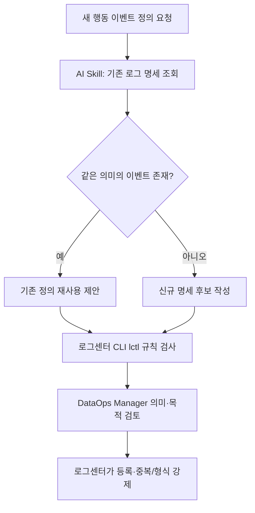

# 머릿속에 있던 로그 정의 기준을 모두의 AI 스킬로 만들기

> [!abstract] 한 줄 정리
> AI가 로그 명세를 임의로 생성하도록 하지 않고, 기존 명세 조회·CLI 규칙 검사·사람의 최종 승인을 결합해 도메인마다 일관된 로그 정의를 만드는 방법을 보여준다.

> 토스 기술 블로그 · 박주영·김서원·조애라 · 2026-10-23

## 한눈에 보기

동일한 사용자 행동을 서비스마다 서로 다른 이름과 파라미터로 로깅하면 집계와 분석에서 일관성이 무너진다. 토스 DataOps는 AI에 새 로그 정의를 무제한으로 생성하게 하는 대신 기존 로그와의 중복을 검색하고 명세 형식을 검증하도록 역할을 나누었다. 문서화와 규칙 검사로 반복 가능한 부분을 자동화해도 도메인 의미에 대한 승인 책임은 사람에게 남는다.

*원문을 토대로 자체 재구성한 학습용 흐름도다.*

AI Skill은 기존 명세 탐색과 대안 제안을 돕고, `lctl`은 명명 규칙·필수 필드처럼 기계적으로 판정 가능한 계약을 검증한다. 최종 도메인 의미와 재사용 가능성 판단을 DataOps Manager에게 남긴 것이 중요한 권한 경계다. 모든 지침을 하나의 거대한 스킬 문서로 만든 첫 시도는 필요한 정보가 누락되므로, 주 작업과 세부 참고 자료를 나눠 탐색하도록 바꿨다.

## 핵심 내용

### 도입 배경과 문제

**문제:** 로그 이름·파라미터·도메인 맥락이 담당자의 경험에 의존해 같은 의미를 서로 다른 이름으로 정의하거나 기존 명세를 중복 생성할 위험이 있었다.

### 선택한 구조와 구현

**접근:** 로그 정의 스킬이 화면과 기존 로그 명세를 검토해 재사용 후보와 새 명세를 제안하고, DataOps Manager가 의미와 목적을 판단해 최종 확정한다.

**구조:** 판단과 안내는 AI 스킬, 기계적으로 검증 가능한 형식 규칙은 로그센터 CLI `lctl`, 발행 거절과 저장은 로그센터가 담당한다. 스킬은 CLI에 포함해 팀 단위로 배포한다.

### 실행 결과와 한계

**시행착오:** 규칙과 절차를 한 문서에 넣자 AI가 중요한 내용을 놓쳤다. 작업별 참고 문서로 나누고 스킬에는 필요한 문서의 탐색 방법만 남겼다.

**결과·주의점:** 실제 사용 사례에서 기존 로그를 대부분 재사용하고 새 로그는 1개만 만든 경우가 있었다. 전체 조직의 정량적 시간 절감률은 제시되지 않았으며, 도메인 판단은 계속 사람이 담당한다.

### 설계 선택과 핵심 수치

| 계층 | 실제 역할 | 넘기지 않은 권한 |
| --- | --- | --- |
| AI Skill | 기존 명세 탐색·신규 후보 작성 | 비즈니스 의미 확정 |
| lctl CLI | 형식·명명 등 결정적 규칙 검증 | 도메인 판단 |
| DataOps Manager | 중복·의미·목적 리뷰 | 정적 규칙을 임의 우회하지 않음 |
| 로그센터 | 허용된 스키마 저장·거부 | 잘못된 형식 허용하지 않음 |

*실제 사례 중 기존 정의를 대부분 재사용하고 새 로그 하나만 추가한 경우가 있었지만 전사적 시간 절감률은 제시되지 않았다.*

## 왜 읽을까

AI가 제안하는 작업과 시스템이 강제하는 불변 규칙을 구분하는 실무 사례다. 스키마 표준화에서 중요한 것은 자동 생성 속도가 아니라 기존 정의의 의미를 유지하고 잘못된 변경을 차단하는 검증 경계라는 점을 배울 수 있다.

**프로젝트에 적용 — DevPedia**

- [ ] 모집글 조회·지원·승인·거절 등 사용자 행동 이벤트의 이름과 필수 속성을 작은 로그 명세로 정의한다.
- [ ] 새로운 이벤트를 추가하기 전에 기존 이벤트·파라미터를 검색하고 의미가 같은지 검토한다.
- [ ] 필수 필드·명명 규칙은 테스트나 정적 검증으로 강제하고, 비즈니스 의미 판단은 직접 검토한다.

---

**원문:** [머릿속에 있던 로그 정의 기준을 모두의 AI 스킬로 만들기](https://toss.tech/article/dataops-log-definition-skill)
