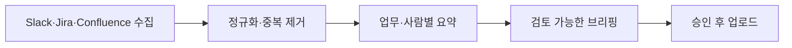

# 클로드 코드로 개발 팀장의 하루를 재설계한 이야기

> [!abstract] 한 줄 정리
> AI에 모든 일을 한꺼번에 맡기기보다 반복 수집은 스크립트로, 요약·판단은 AI로, 확정은 사람에게 분리하면 비용과 재현성을 개선하면서 업무 지식을 축적할 수 있다.

> 컬리 기술 블로그 · 한경훈 · 2026-04-20

## 핵심 내용

- **문제:** Slack·Jira·Confluence를 직접 확인해 아침 현황을 정리하는 데 오전이 소모됐고, AI가 MCP로 원문을 매번 가져오는 방식은 **2~3일치**만 수집해도 토큰 비용과 시간이 급격히 늘었다. - **접근:** 외부 원문 수집을 재사용 가능한 스크립트로 분리하고 AI에는 정리와 판단을 맡겼다. 브리핑을 **수집 → 사람·과제별 요약 → 페이지 생성 → 업로드** 네 단계로 쪼개 실패 구간만 재실행할 수 있게 했다. - **결과:** 브리핑을 약 **15분**에 읽을 수 있게 됐고, 작성자는 하루 **1시간 가까이**를 확보했다고 설명한다. 이는 개인 경험에 기반한 수치로 조직 전체 성과는 아니다.

- **구조:** 회의와 설계 논의에서 확인한 용어·정책·결정을 별도 파일에 축적한다. 여러 워크플로의 `CLAUDE.md`가 공통 규칙을 참조하고, 개별 세션에서 발견한 교정 사항은 제안함에 모아 승인 후 공통 규칙으로 승격한다. - **주의점:** AI가 여러 역할을 맡아 토론해도 잘못된 전제를 검증하고 최종 판단하는 책임은 사람에게 남는다. 공통 규칙의 과도한 비대화와 충돌도 별도로 점검한다.

여러 업무 도구의 원문을 AI에게 매번 직접 가져오도록 맡기면 검색 결과가 길어질수록 토큰 비용과 결측 위험이 함께 증가한다. 원문 수집을 별도 스크립트로 분리하고 AI에는 차이점 요약과 판단 보조를 맡긴 구조는 **검색·정제·추론의 역할을 분리**한 것이다. 브리핑을 수집, 대상별 요약, 페이지 생성, 업로드로 쪼개면 특정 단계가 실패해도 전체 내용을 처음부터 다시 생성할 필요가 없다.

*자체 재구성. 인용 출처를 남기는 수집 단계와 AI가 작성하는 요약 단계를 분리한다.*

공통 `CLAUDE.md` 지침이 유용해도 세션마다 관찰된 사실을 그대로 공통 규칙으로 병합하면 일시적인 오류가 조직의 정답처럼 남을 수 있다. 제안함에서 근거를 확인하고 승인한 규칙만 승격하는 구조가 지속 가능한 지식 관리 방식이다.

## 왜 읽을까

AI 워크플로를 프롬프트 묶음이 아닌 수집·판단·승인·학습의 파이프라인으로 설계하는 방법을 볼 수 있다. 반복된 실패를 단순히 기록하지 않고 다음 실행의 행동 규칙으로 바꾸는 피드백 구조가 특히 유용하다.

**프로젝트에 적용 — PawCycle**

- [ ] 리버스 엔지니어링 중 반복되는 코드·배포 정보 수집은 스크립트로 고정하고 AI에는 차이 분석을 맡긴다.
- [ ] 확인된 도메인 규칙·운영 절차·설계 결정은 출처가 있는 문서로 축적한다.
- [ ] Codex 작업에서 재발한 오류는 프로젝트 지침 개선안으로 모으되, 검토 후에만 반영한다.

---

**원문:** [클로드 코드로 개발 팀장의 하루를 재설계한 이야기](https://helloworld.kurly.com/blog/claude-code-redesign-my-day)
