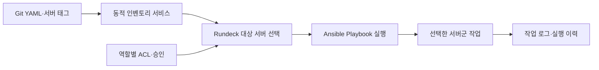

# Ansible과 Rundeck을 활용한 서버 작업 자동화 및 권한 제어

> [!abstract] 한 줄 정리
> 운영 자동화의 핵심은 모든 명령을 무인 실행하는 것이 아니라, 반복 작업을 표준화하고 실행 대상·권한·이력을 통제해 사람의 실수와 직접 접속 위험을 줄이는 데 있다.

> LY Corporation Tech Blog · 유재훈, 서동규 · 2023-10-06

## 한눈에 보기

운영 자동화는 원격 명령 실행 버튼을 많이 만드는 일만이 아니다. 어떤 사용자가 어떤 서버를 대상으로 무슨 명령을 실행할 수 있는지, 실행 결과와 승인 이력을 어떻게 남길지가 먼저 정해져야 한다. LINE Pay는 Ansible의 구성 관리 기능과 Rundeck의 작업 실행·ACL·이력 관리를 조합해 수작업 접속의 위험을 줄였다.

*원문을 토대로 자체 재구성한 학습용 흐름도다.*

정적인 hosts.ini로 서버 목록을 직접 유지하면 인스턴스 교체와 조직 변경에 따라 대상 누락·과잉 적용이 생길 수 있다. 동적 인벤토리에서 서버·팀·태그를 조회하면 작업 범위를 최신 운영 정보와 연결할 수 있다. 단순 상태 조회와 쓰기 작업을 같은 권한으로 묶지 않고, 예측하기 어려운 임의 명령은 Super Admin으로 제한한 점이 안전한 자동화의 핵심이다.

## 핵심 내용

### 도입 배경과 문제

**문제:** LINE Pay는 수천 대 서버와 약 100개 하위 도메인을 운영하면서 서버별 버전 확인과 비정기 명령 수행이 복잡해졌다. 개발자 직접 접속과 수작업은 실수·보안 위험을 높였다.

### 선택한 구조와 구현

**구조:** Ansible로 구성 관리를 코드화하고 Rundeck으로 실행 UI·워크플로·스케줄·ACL을 관리했다. 서버 그룹별 애플리케이션·버전은 Git의 YAML로 관리한다.

**접근:** 정적 hosts.ini 대신 동적 인벤토리 서비스에서 서버·팀·태그 정보를 조회해 대상 서버 목록과 접근 범위를 자동 반영했다.

### 실행 결과와 한계

**보안:** 역할에 따라 서버 조회와 작업 실행 권한을 분리했다. 예측하기 어려운 임의 원격 명령은 Super Admin에만 허용하고, 변경은 개발·운영 양쪽의 리뷰를 거치게 했다.

**수치:** 약 9개월간 1,600여 건을 자동화했다. 설치 56건, 설정 갱신 93건, 인증서 교체 51건, 시스템·파일 조회 989건, 네트워크 조회 428건으로 원문에 제시돼 있다.

### 설계 선택과 핵심 수치

| 작업 유형(9개월 관찰) | 실행 건수 | 권한 설계상 참고 |
| --- | ---: | --- |
| 시스템·파일 조회 | 989 | 읽기 전용 작업을 넓게 허용할 여지 |
| 네트워크 조회 | 428 | 네트워크 접근 대상 통제 |
| 설정 갱신 | 93 | 별도 승인·롤백 필요 |
| 설치 | 56 | 변경 이력 및 영향 범위 확인 |
| 인증서 교체 | 51 | 만료·비밀값 노출 방지 |

*원문은 약 9개월간 총 1,600여 건의 운영 작업 자동화를 보고한다.*

## 왜 읽을까

자동화 범위를 선정할 때 작업 빈도와 위험을 먼저 평가하고, 모든 자동화를 동일한 권한으로 실행하지 않는다는 점이 실무적이다. Git 이력과 역할 기반 접근 제어가 운영 변경의 책임 소재를 어떻게 명확하게 하는지도 배울 수 있다.

**프로젝트에 적용 — PawCycle**

- [ ] OCI 운영에서 반복되는 상태 조회·로그 확인·배포 점검을 읽기 전용 스크립트로 먼저 표준화한다.
- [ ] 설정 변경과 재시작 같은 쓰기 작업은 별도 승인·권한·롤백 절차로 분리한다.
- [ ] 작업 시각·실행자·대상·결과를 기록하고 Secret이 로그에 노출되지 않는지 점검한다.

---

**원문:** [Ansible과 Rundeck을 활용한 서버 작업 자동화 및 권한 제어](https://techblog.lycorp.co.jp/ko/improve-operation-environment-with-rundeck)
