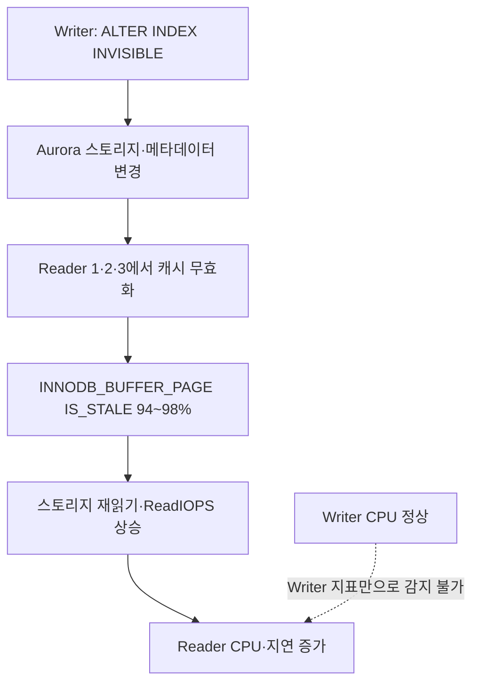

# Aurora MySQL 인덱스 DDL이 Reader 버퍼풀을 비운다?

> [!abstract] 한 줄 정리
> Aurora MySQL에서 인덱스를 INVISIBLE로 바꾸는 메타데이터 중심 DDL이 예상과 달리 Reader의 테이블 캐시를 무효화했다. Writer 지표만 보면 놓치는 장애를 재현 실험과 버퍼풀 내부 상태로 입증한 사례다.

> 당근 기술 블로그 · Eden(이든) · 2026-09-17

## 한눈에 보기

인덱스를 사용하지 못하도록 표시하는 INVISIBLE DDL은 논리적으로 가벼운 메타데이터 변경처럼 보일 수 있다. 그런데 특정 Aurora MySQL 엔진에서는 이 변경을 수행하자 Writer가 아닌 Reader 노드들에서만 I/O와 CPU 사용량이 상승했다. 버퍼풀 메모리가 계속 할당되어 있다는 사실만으로 캐시 데이터가 유효하다고 결론 내릴 수 없다는 점이 핵심이다.

*원문을 토대로 자체 재구성한 설명용 도식이며 원본 도식의 전재가 아니다.*

원문은 Writer 1대·Reader 3대의 실험에서 인덱스를 INVISIBLE로 변경한 뒤 Reader 지표가 급증한 원인을 추적했다. 전체 버퍼풀 크기가 약 8GB로 유지되더라도 페이지의 `IS_STALE` 비율이 94~98%라면 실제 재사용할 수 있는 캐시는 크게 줄어든 것이다. 별도 클러스터에서 여러 DDL 알고리즘을 비교한 뒤 공급사에 엔진 결함을 재현해 전달한 증거 확보 과정이 중요하다.

## 핵심 내용

### 문제의 발단

**문제:** Aurora MySQL 3.10.x의 Writer 1대·Reader 3대 환경에서 미사용 인덱스 6개를 단계적으로 정리하려 했다. INDEX INVISIBLE을 3회 실행할 때 Reader 3대에서만 CPU가 약 30%→50~60%, ReadIOPS가 평소 수백→3.1K로 증가했고 Writer 지표는 안정적이었다.

### 구조와 검증 과정

**접근:** 모든 노드의 `performance_schema.table_io_waits_summary_by_index_usage`를 1주 간격 두 차례 비교해 미사용 인덱스를 선별했다. 바로 DROP하지 않고 INVISIBLE로 변경한 뒤 관찰하려는 점진적 절차였다.

**원인 분석:** `INNODB_BUFFER_PAGE`의 전체 페이지 수는 약 8GB 수준으로 유지됐지만 `IS_STALE`을 확인하자 PRIMARY와 다른 인덱스의 94~98%가 무효 상태로 바뀌었다. 인덱스 한 개가 아니라 해당 테이블 전체 캐시가 영향을 받은 것이다.

### 실측·운영 판단

**재현:** 별도 클러스터에서 INSTANT, INPLACE, COPY, CREATE/DROP/RENAME INDEX 등을 비교했다. rebuild 없는 인덱스 DDL에서도 캐시 무효화가 발생함을 확인했고, AWS는 Aurora MySQL 3.08.0부터 유입된 엔진 결함이라고 인정했다.

**주의점:** 원문 작성 당시 AWS는 3.14에 수정이 포함될 예정이라고 안내했고 3.10 LTS에 백포트 계획은 없었다. 적용 전에는 실제 엔진 버전과 릴리스 상태를 재확인해야 하며, `INNODB_BUFFER_PAGE` 조회 자체도 운영 부하를 유발할 수 있다.

### 주요 지표와 비교

| 지표·조건 | 변경 전 | DDL 직후 | 해석 |
| --- | --- | --- | --- |
| Reader CPU | 약 30% | 50~60% | Reader 위주 성능 영향 |
| Reader ReadIOPS | 수백 수준 | 약 3.1K | 캐시 무효화 뒤 재읽기 증가 |
| 버퍼풀 총 페이지 | 약 8GB 규모 | 큰 변화 없음 | 할당량은 유효성의 증거가 아님 |
| 주요 페이지 IS_STALE | 별도 확인 필요 | 약 94~98% | 무효 상태 비율 급증 |
| Writer 상태 | 안정적 | 안정적 | Writer 지표만으로 문제 놓칠 수 있음 |

*원문에서 확인한 Aurora MySQL 3.10.x 환경의 회귀 현상이다. 모든 MySQL 또는 모든 Aurora 버전의 일반적 동작으로 확대 해석해서는 안 된다.*

## 왜 읽을까

DDL의 논리적 의미만 보고 운영 영향이 없다고 판단하면 위험하다. Writer와 Reader를 분리해 관찰하고, 캐시 페이지 수와 실제 유효성을 구별하며, 공급사에 재현 가능한 증거를 제시하는 과정이 탁월하다.

특정 Aurora 버전의 결함이므로 일반 MySQL이나 모든 Aurora 버전에 같은 현상이 있다고 확대 해석해서는 안 된다.

**프로젝트에 적용 — PawCycle**

- [ ] 현재 Managed MySQL의 정확한 엔진 종류·버전과 읽기 복제본 유무를 확인한다.
- [ ] 인덱스 변경 전후 CPU, 읽기 I/O, 캐시 히트율, 느린 쿼리 지표를 기록하는 DDL 점검표를 만든다.
- [ ] 운영 DB에 바로 적용하지 않고 별도 테스트 DB에서 인덱스 변경·복구 경로와 잠금 영향을 검증한다.

---

**원문:** [Aurora MySQL 인덱스 DDL이 Reader 버퍼풀을 비운다?](https://medium.com/daangn/aurora-mysql-%EC%9D%B8%EB%8D%B1%EC%8A%A4-ddl%EC%9D%B4-reader-%EB%B2%84%ED%8D%BC%ED%92%80%EC%9D%84-%EB%B9%84%EC%9A%B4%EB%8B%A4-16c6328dea50)
