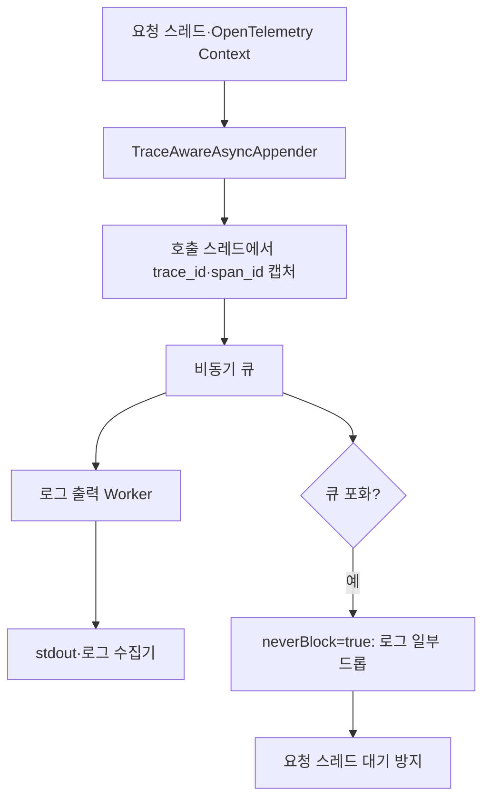

# 로그가 서비스를 죽였다

> [!abstract] 한 줄 정리
> 분산 추적 ID를 보존하려고 동기 로깅을 강제한 결정이, 로그 폭증 시 요청 스레드와 DB 커넥션 풀을 함께 멈추게 했다. 비동기 큐에 넣기 전에 요청 스레드에서 추적 컨텍스트를 캡처해 가용성과 관측성을 함께 지켰다.

> 무신사 기술 블로그 · 조현근 · 2026-10-01

## 한눈에 보기

로깅은 요청을 관측하기 위한 보조 기능이지만 동기 출력이 막히면 비즈니스 요청의 가용성까지 끌어내릴 수 있다. 무신사 사례에서는 DEBUG 로그 급증으로 stdout 파이프가 포화되면서 요청 스레드가 출력에 묶였고, DB 커넥션 반환도 지연되어 HikariCP 풀 고갈로 확산됐다. 비동기 로그 전환 시 사라지는 추적 컨텍스트는 큐에 넣기 전 호출 스레드에서 캡처하는 방식으로 해결했다.

*원문을 토대로 자체 재구성한 설명용 도식이며 원본 도식의 전재가 아니다.*

기존 동기 Logback은 요청 스레드에서 즉시 stdout에 `write()`를 호출했기 때문에 버퍼 압박이 애플리케이션의 대기와 락 경합으로 전파되었다. 일반 AsyncAppender의 워커에서 `Span.current()`를 읽으면 원래 요청의 ThreadLocal 컨텍스트가 없어서 trace ID가 비는 문제가 있었다. 따라서 로그 이벤트를 비동기화하기 **직전** 추적 식별자를 이벤트 래퍼에 담는 별도 Appender가 필요했다.

## 핵심 내용

### 문제의 발단

**문제:** 운영 중 DEBUG 로그가 평소 약 100배로 증가하면서 stdout 파이프 버퍼(약 64KB)가 포화됐다. 동기 Logback 출력에서 요청 스레드가 `write()`와 락 대기에 묶였고, DB 커넥션 반환이 지연돼 HikariCP가 고갈되면서 요청이 약 30초 주기로 실패했다.

### 구조와 검증 과정

**원인:** 사내 표준 로깅 라이브러리는 OpenTelemetry `Span.current()`로 trace_id를 조회했다. 비동기 워커 스레드에서는 요청 스레드의 ThreadLocal 컨텍스트를 읽지 못해 ID가 사라졌고, 이를 막으려 AsyncAppender를 금지했던 정책이 가용성 위험을 키웠다.

**접근:** `TraceAwareAsyncAppender`가 caller 스레드의 `append()`에서 trace_id·span_id를 먼저 캡처해 이벤트 래퍼에 담고, 기존 AsyncAppender의 큐·워커 구조를 재사용했다. `neverBlock=true`로 큐 포화 시 로그 일부를 버리고 요청 스레드의 대기는 막았다.

### 실측·운영 판단

**수치:** 초당 약 1,500줄에서 로그 드롭 약 33%, 초당 15,000줄을 20분 유지한 극한 부하에서 약 65% 드롭을 관찰했다. 실제 출력된 약 313만 줄의 trace_id 결측은 0%였고, 로그량 15,000줄/초 고정 비교에서 요청 p95는 29ms였다.

**트레이드오프:** 로그 유실을 허용해 서비스 가용성을 우선했지만, 지속적으로 생산량이 소비량을 초과하면 비동기 큐도 포화된다. 로그 레벨·발생량 관리가 별도로 필요하다.

### 주요 지표와 비교

| 측정 상황 | 관찰된 값 | 의사결정상 의미 |
| --- | --- | --- |
| DEBUG 로그 증가 | 평소 대비 약 100배 | stdout 약 64KB 파이프 포화와 결합 |
| 출력 약 1,500줄/초 | 로그 드롭 약 33% | 서비스 스레드 비차단 대신 일부 관측 손실 |
| 극한 15,000줄/초·20분 | 로그 드롭 약 65% | 큐 지속 포화의 한계 |
| 실제 출력 약 313만 줄 | trace ID 결측 0% | 출력된 이벤트의 추적 정보 보존 |
| 15,000줄/초 부하 | 요청 P95 약 29ms | 극한 실험 조건의 지연 관측 |

*드롭 비율은 손실을 감수한 가용성 선택이며, 비동기화만으로 로그 생성량 문제가 해결되지는 않는다.*

## 왜 읽을까

관측성을 높이기 위한 표준이 운영 장애의 원인이 될 수 있음을 보여준다. 스레드 덤프, 커넥션 풀 타임아웃, stdout 버퍼라는 서로 다른 계층의 단서를 연결해 실제 원인을 좁혀 가는 사고방식을 배울 수 있다.

'동기냐 비동기냐'라는 양자택일 대신 컨텍스트를 캡처하는 시점을 바꿔 제약을 제거한 설계 판단이 핵심이다.

**프로젝트에 적용 — PawCycle**

- [ ] Spring Boot 로깅 설정에서 운영 DEBUG 활성화 여부, 콘솔 Appender 종류, 로그 수집 경로를 확인한다.
- [ ] 격리된 로컬 환경에서 로그 발생량을 높여 p95 응답 시간과 HikariCP active/pending, 로그 유실 여부를 함께 측정한다.
- [ ] 비동기 로깅을 검토할 경우 trace\_id 전파와 큐 포화 시 드롭 정책을 테스트하고, 운영 환경 변경은 별도로 승인한다.

---

**원문:** [로그가 서비스를 죽였다](https://techblog.musinsa.com/%EB%A1%9C%EA%B7%B8%EA%B0%80-%EC%84%9C%EB%B9%84%EC%8A%A4%EB%A5%BC-%EC%A3%BD%EC%98%80%EB%8B%A4-4013e35a463b)
