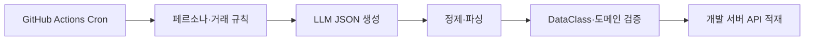

# 뱅크샐러드에서 테스트 데이터를 생성하는 방법 (feat. LLM)

> [!abstract] 한 줄 정리
> 복잡하고 서로 연관된 테스트 데이터를 LLM으로 생성하되 JSON 유효성 검증과 API 적재, 정기 실행을 별도 단계로 두면 QA가 장기간의 현실적인 시나리오를 반복적으로 검증할 수 있다.

> 뱅크샐러드 기술 블로그 · 송의초경 · 2024-11-18

## 핵심 내용

마이데이터 기반 서비스의 테스트 데이터는 단순히 거래 내역을 무작위로 많이 생성하는 것으로 충분하지 않다. 카드 결제·은행 입출금·투자·대출 상환처럼 데이터 사이에 관계가 있고 시간이 지남에 따라 상태가 이어져야 한다. 뱅크샐러드는 사용자 페르소나와 소비 패턴, JSON 스키마와 few-shot 예시를 포함한 프롬프트로 장기간의 합성 데이터를 생성했다.

은행·카드·대출·보험·투자 정보가 서로 연관되고 시간이 흐르며 변하는 마이데이터 특성상 테스트 데이터를 매번 수작업으로 준비하기 어려웠다.

사용자 페르소나, 소비 성향, JSON 출력 형식, few-shot 예시를 프롬프트에 포함해 장기간의 거래 내역을 생성했다.



*원문에서 확인한 사실을 바탕으로 가로 방향으로 자체 재구성한 개념도다.*

생성한 응답에는 JSON 외에 코드펜스나 자연어 설명이 섞일 수 있어 별도 파싱·정제 과정을 거쳐야 했다. 정제한 결과를 Kotlin/Java DataClass에 매핑하고 유효성을 검사한 다음에만 개발 서버 API로 적재한다. GitHub Actions Cron은 이 과정을 매일 실행하지만 자동화가 반복된다는 사실만으로 데이터의 정합성이 검증되는 것은 아니다. 테스트 격리와 민감한 실제 금융정보의 사용 금지도 별도 조건이다.

```json
// 실제 개인정보를 쓰지 않는 학습용 최소 합성 레코드
{"persona":"monthly-pay","transactions":[{"date":"2026-01-10","amount":-12000}]}
```

구조가 유효하더라도 잔액·상환일·상품 상태 등 데이터 간 관계 검증이 추가로 필요하다.

LLM 결과에서 Markdown·불필요한 설명을 제거한 뒤 JSON 파싱 및 유효성 검사를 수행하고 Kotlin/Java DataClass로 매핑했다. 생성물을 무검증으로 DB에 넣지 않았다.

가공한 JSON을 개발 서버 API로 적재하고 GitHub Actions의 Cron Job으로 매일 데이터를 생성·업로드하도록 자동화했다.

월별·요일별 생활 패턴이 드러나는 데이터를 여러 페르소나 계정에 공급하고 장기간 내역 테스트에 활용했다. 정량적인 생성 시간 절감률이나 데이터 정확도는 공개하지 않았다.

| 단계 | 입력 또는 결과 | 실패 시 처리할 내용 |
| --- | --- | --- |
| 생성 | 페르소나·거래 패턴·JSON 출력 계약 | 다른 설명이 섞인 응답 식별 |
| 구조 검증 | JSON 파싱, Kotlin/Java DataClass | 필수 필드·타입 위반 거절 |
| 의미 검증 | 기간·잔액·거래 관계 | 모순된 거래와 경계 데이터 확인 |
| 자동 적재 | 검증된 데이터를 개발 서버 API로 전달 | API 오류·중복 실행·기존 데이터 영향 관리 |

*원문은 실제 생성·적재 활용을 소개하지만 작업시간 절감률이나 정확도 향상 수치는 공개하지 않았다.*

이 접근의 가치는 QA가 장기간 데이터를 수작업으로 준비하던 부담을 줄이고 페르소나별 시간적 패턴을 반복 검증할 수 있다는 데 있다. 다만 LLM이 그럴듯하게 만든 거래가 도메인 제약과 항상 일치하지는 않으므로 잔액, 날짜, 상품 상태 간 불변식을 추가로 확인해야 한다. 원문은 사용 사례를 공개했지만 정량적인 생성 시간 절감률은 제시하지 않았다.

## 왜 읽을까

테스트 데이터 생성의 병목이 단순한 레코드 수가 아니라 **도메인 관계와 시간적 일관성**에 있음을 보여준다. AI 출력은 후보 데이터이고, 구조·도메인 제약 검증과 적재 자동화가 별도로 필요하다는 관점을 얻을 수 있다.

**프로젝트에 적용 — DevPedia**

- [ ] 모집글·지원자·지원 상태·마감일이 서로 모순되지 않는 합성 데이터 시나리오를 정의한다.
- [ ] 생성한 데이터는 DTO 검증과 DB 제약조건을 통과할 때만 테스트 DB에 적재한다.
- [ ] 모집 마감, 중복 지원, 승인·거절 등의 경계 사례를 별도 고정 fixture로 보존한다.
- [ ] 운영 개인정보 대신 합성 데이터만 사용하고 테스트 실행 간 데이터 격리를 보장한다.

---

**원문:** [뱅크샐러드에서 테스트 데이터를 생성하는 방법 (feat. LLM)](https://blog.banksalad.com/tech/how-banksalad-testdata/)
