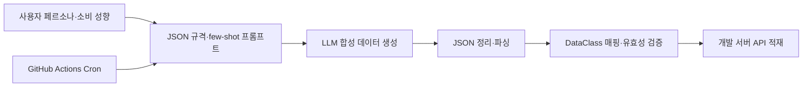

# 뱅크샐러드에서 테스트 데이터를 생성하는 방법 (feat. LLM)

> [!abstract] 한 줄 정리
> 복잡하고 서로 연관된 테스트 데이터를 LLM으로 생성하되 JSON 유효성 검증과 API 적재, 정기 실행을 별도 단계로 두면 QA가 장기간의 현실적인 시나리오를 반복적으로 검증할 수 있다.

> 뱅크샐러드 기술 블로그 · 송의초경 · 2024-11-18

## 한눈에 보기

금융 데이터 테스트는 임의로 거래 기록을 여러 건 만드는 것으로 끝나지 않는다. 카드 지출·계좌 거래·투자·보험 정보는 서로 연관되고 날짜가 바뀌면 잔액과 상태도 이어져야 한다. 뱅크샐러드는 페르소나와 소비 습관을 프롬프트로 제공해 장기간의 합성 데이터를 만들고, 생성된 JSON을 검증한 뒤 개발 환경에 적재하는 흐름을 구성했다.

*원문을 토대로 자체 재구성한 설명용 도식이며 원본 도식의 전재가 아니다.*

LLM 출력은 확정된 테스트 데이터가 아니라 **검증 대상 후보**다. 코드펜스·불필요한 해설을 제거하고 JSON으로 파싱할 수 있어도 도메인 관계나 날짜의 정합성이 자동으로 증명되는 것은 아니다. 반복 실행은 GitHub Actions가 담당하되 실제 API 적재는 스키마와 도메인 제약을 통과한 후에만 수행하도록 분리했다.

## 핵심 내용

### 문제의 발단

**문제:** 은행·카드·대출·보험·투자 정보가 서로 연관되고 시간이 흐르며 변하는 마이데이터 특성상 테스트 데이터를 매번 수작업으로 준비하기 어려웠다.

### 구조와 검증 과정

**접근:** 사용자 페르소나, 소비 성향, JSON 출력 형식, few-shot 예시를 프롬프트에 포함해 장기간의 거래 내역을 생성했다.

**검증:** LLM 결과에서 Markdown·불필요한 설명을 제거한 뒤 JSON 파싱 및 유효성 검사를 수행하고 Kotlin/Java DataClass로 매핑했다. 생성물을 무검증으로 DB에 넣지 않았다.

### 실측·운영 판단

**구조:** 가공한 JSON을 개발 서버 API로 적재하고 GitHub Actions의 Cron Job으로 매일 데이터를 생성·업로드하도록 자동화했다.

**결과·한계:** 월별·요일별 생활 패턴이 드러나는 데이터를 여러 페르소나 계정에 공급하고 장기간 내역 테스트에 활용했다. 정량적인 생성 시간 절감률이나 데이터 정확도는 공개하지 않았다.

### 주요 지표와 비교

| 단계 | 입력 또는 결과 | 실패 시 처리할 내용 |
| --- | --- | --- |
| 생성 | 페르소나·거래 패턴·JSON 출력 계약 | 다른 설명이 섞인 응답 식별 |
| 구조 검증 | JSON 파싱, Kotlin/Java DataClass | 필수 필드·타입 위반 거절 |
| 의미 검증 | 기간·잔액·거래 관계 | 모순된 거래와 경계 데이터 확인 |
| 자동 적재 | 검증된 데이터를 개발 서버 API로 전달 | API 오류·중복 실행·기존 데이터 영향 관리 |

*원문은 실제 생성·적재 활용을 소개하지만 작업시간 절감률이나 정확도 향상 수치는 공개하지 않았다.*

## 왜 읽을까

테스트 데이터 생성의 병목이 단순한 레코드 수가 아니라 **도메인 관계와 시간적 일관성**에 있음을 보여준다. AI 출력은 후보 데이터이고, 구조·도메인 제약 검증과 적재 자동화가 별도로 필요하다는 관점을 얻을 수 있다.

**프로젝트에 적용 — DevPedia**

- [ ] 모집글·지원자·지원 상태·마감일이 서로 모순되지 않는 합성 데이터 시나리오를 정의한다.
- [ ] 생성한 데이터는 DTO 검증과 DB 제약조건을 통과할 때만 테스트 DB에 적재한다.
- [ ] 모집 마감, 중복 지원, 승인·거절 등의 경계 사례를 별도 고정 fixture로 보존한다.
- [ ] 운영 개인정보 대신 합성 데이터만 사용하고 테스트 실행 간 데이터 격리를 보장한다.

---

**원문:** [뱅크샐러드에서 테스트 데이터를 생성하는 방법 (feat. LLM)](https://blog.banksalad.com/tech/how-banksalad-testdata/)
