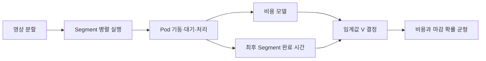

# 감으로 맞추던 값을 식을 세워서 Kubernetes 최적화하기

> [!abstract] 한 줄 정리
> Kubernetes 리소스 설정은 감으로 조정하기보다 비용과 완료 시간을 별도 식으로 모델링하고 실제 운영 수치로 검증해야 한다. 비용과 시간에 반대 방향으로 작용하는 변수를 찾아 비즈니스 마감 조건에 맞게 선택했다.

> WATCHA 기술 블로그 · Seungwoo Lee · 2026-10-10

## 핵심 내용

영상 인코딩을 Kubernetes 배치 작업으로 이전한 WATCHA는 Pod를 많이 띄우면 항상 빠르다는 직관이 비용·대기·기동 시간과 맞지 않는다는 문제를 겪었다. 분할된 Segment 개별 실행 시간과 전체 영상이 완료되는 시간을 다른 지표로 구분했고, 리소스 비용과 최종 완료 시각을 서로 다른 식으로 모델링해 실제 관측값과 비교했다.

영상 인코딩을 VM에서 Kubernetes Pod 기반으로 옮기자 확장 임계값, 기동·대기·종료 시간, 재작업 비용이 얽혀 최적 설정을 직관으로 결정하기 어려워졌다.

Segment당 비용을 Pod 단가·처리 시간·대기·기동·재작업 낭비로, 전체 완료 시간을 가장 늦게 끝나는 Segment의 종료 시간으로 모델링했다.



*원문 사실을 바탕으로 가로 방향으로 자체 재구성한 학습용 흐름도다.*

동시 실행을 줄이거나 확장 임계값을 바꾸면 개별 작업 시간은 길어져도 자원 경합과 재작업·대기가 줄 수 있다. 원문에서는 확장 임계값 V=2를 선택하면서 모든 작업이 무조건 마감을 지키는 기준이 아니라 일부 지연을 허용하는 확률적 마감 조건도 반영했다. 수학식을 만들었다는 것 자체가 근거가 아니라 측정된 Pod 비용·기동·대기·재작업 값을 대입해 유효성을 확인한 과정이 중요하다.

```text
# 자체 재구성한 성능 평가 관점
총비용 = 실행 비용 + 유휴·기동 비용 + 재작업 비용
전체완료 = 모든 Segment가 끝나는 마지막 시점
```

*실제 비용 모델의 계수와 측정 단위는 원문에서 사용한 실험 조건을 따른다.*

확장 임계값 V를 높이면 Pod 수와 비용은 줄지만 처리 시간은 늘어난다. 영상 길이 편차를 고려해 '일정 비율은 마감 초과 허용'하는 확률적 마감 기준으로 V=2를 선택했다.

운영 적용 후 작업 시간당 비용이 약 77에서 20~42로 낮아져 45~74% 절감됐다. 작업 1시간당 자원 가동 시간은 350에서 128로 감소했다.

개별 인코딩 단계 시간은 2.3배 늘었지만 전체 완료 시간은 14%, 가장 느린 상위 5% 작업의 완료 시간은 35% 단축됐다. AI가 제안한 식은 실측과 대조하며 여러 번 수정했다.

| 원문 관측 지표 | 변경 후 결과 | 판단 |
| --- | --- | --- |
| 작업 시간당 비용 | 약 77 → 20~42 | 45~74% 감소 |
| 리소스 가동 시간 | 350 → 128 | 유휴 부담 감소 |
| 개별 단계 처리 시간 | 2.3배 증가 | 단계 단위로만 보면 악화 |
| 전체 완료 시간 | 14% 단축 | 시스템 전체로는 개선 |
| 최장 지연 5% 작업 | 35% 단축 | 꼬리 지연까지 개선 |

*각 수치는 원문 환경의 관측치이며 범용 Kubernetes 설정값이 아니다.*

결과적으로 원문에서는 작업 시간당 비용을 약 77에서 20~42로 낮추고 작업 1시간당 자원 가동 시간을 350에서 128로 줄였다고 보고한다. 개별 인코딩 단계는 약 2.3배 오래 걸렸지만 전체 완료는 약 14%, 느린 상위 5% 작업은 약 35% 단축됐다. 비용과 지연은 같은 분모·측정 단위로 비교해야 하며 해당 영상 처리 워크로드의 수치를 일반 배치 시스템의 설정값으로 가져올 수는 없다.

## 왜 읽을까

단일 지표의 개선이 전체 시스템의 개선과 다를 수 있음을 보여준다. 특히 작업 단계의 처리 시간은 늘었는데도 전체 완료 시간과 비용이 함께 개선된 이유를 변수 간 의존성과 확률적 SLA 관점에서 설명한다.

**프로젝트에 적용 — PawCycle**

- [ ] 배치·비동기 작업의 전체 완료 시간과 개별 작업 시간을 따로 측정한다.
- [ ] 동시 실행 수, 기동·대기 시간, 재시도 비용을 구분해 비용 모델을 만든다.
- [ ] 자원 사용량만 줄이는 설정 대신 p95 완료 시간과 운영 비용을 함께 비교한다.
- [ ] AI가 제안한 최적화 식은 실제 측정치와 대조해 검증한다.

---

**원문:** [감으로 맞추던 값을 식을 세워서 Kubernetes 최적화하기](https://medium.com/watcha/kubernetes-%EB%B0%B0%EC%B9%98-%EC%9B%8C%ED%81%AC%EB%A1%9C%EB%93%9C%EC%9D%98-%EB%B9%84%EC%9A%A9-%EB%AA%A8%EB%8D%B8%EA%B3%BC-%ED%8C%8C%EB%9D%BC%EB%AF%B8%ED%84%B0-%EA%B2%B0%EC%A0%95-3724d2c4ad99)
