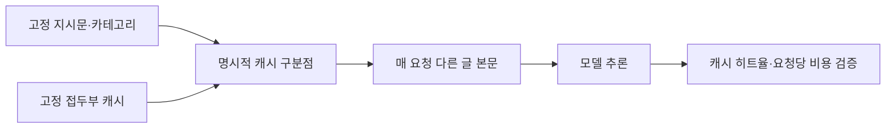

# 모델만 바꿨는데 LLM 비용이 3배가 된 이유

> [!abstract] 한 줄 정리
> LLM 모델의 토큰 단가가 낮아져도 프롬프트 캐시 정책이 바뀌면 요청당 비용은 오히려 급증할 수 있다. 모델 변경은 가격표 비교가 아니라 실제 캐시 히트율과 요청 비용까지 확인하는 운영 변경이다.

> 당근 기술 블로그 · Jaemin Seo(Jay) · 2026-10-21

## 한눈에 보기

언어모델을 바꿀 때 토큰 단가만 비교하면 전체 비용이 줄어들 것이라고 예상하기 쉽다. 그러나 동일한 기능을 수행해도 캐시가 어디까지 재사용되는지는 모델과 요청의 프롬프트 구조에 따라 달라진다. 당근의 사례에서는 기본 단가가 더 낮은 모델로 변경한 직후 오히려 요청당 비용이 급등했고, 캐시 히트율을 조사해 원인을 찾았다.

*원문을 토대로 자체 재구성한 설명용 도식이며 원본 도식의 전재가 아니다.*

프롬프트 앞부분의 고정 지시문이 반복되어도 캐시 경계가 가변 본문 뒤에 놓이면 매번 다른 접두부로 인식되어 재사용률이 낮아질 수 있다. 고정 구간 끝에 명시적인 캐시 구분점을 두면 변경되는 본문과 반복되는 지침을 분리해서 비용을 계산할 수 있다. 모델 교체는 응답 품질 테스트뿐 아니라 캐시 읽기·쓰기 토큰과 요청당 실비를 함께 확인해야 하는 운영 변경이다.

## 핵심 내용

### 문제의 발단

**문제:** 주제 분류 모델을 Gemini에서 단가가 20% 낮은 GPT-5.6으로 변경한 뒤, 에러 없이 요청당 비용이 3.2배로 증가했다.

### 구조와 검증 과정

**수치:** 입력 토큰 기준 캐시 히트율이 85.8%에서 2.3%로 떨어졌다. 원인은 모델별 캐시 구분점 동작 차이였다.

**구조:** 반복되는 고정 지시문·카테고리 목록 뒤에 매 요청 달라지는 글 본문이 붙는다. 캐시 구분점이 가변 입력 뒤에만 놓이면 매 요청 서로 다른 접두부를 저장해 재사용률이 낮아진다.

### 실측·운영 판단

**접근:** 고정 지시문 끝에 명시적 캐시 구분점을 두고, 공통 템플릿의 첫 변수 앞에 이를 자동 삽입하도록 개선했다.

**결과:** 히트율이 약 95%로 회복됐고 요청당 비용은 문제 발생 상태 대비 약 1/5로 줄었다. 캐시 쓰기 할증과 읽기 할인에 따라 히트율 약 22% 아래에서는 캐시가 더 비쌀 수 있다는 계산도 제시한다.

### 주요 지표와 비교

| 확인 단계 | 캐시 히트율 | 요청당 비용과 의미 |
| --- | ---: | --- |
| 기존 모델 사용 | 약 85.8% | 교체 전 기준선 |
| 새 모델로 변경 직후 | 약 2.3% | 단가는 약 20% 낮았으나 요청당 비용 약 3.2배 |
| 캐시 경계 명시 후 | 약 95% | 문제 상태 대비 요청당 비용 약 1/5 |

*원문에서 설명한 약 22% 손익분기점은 해당 요금·캐시 쓰기/읽기 할인 구조를 전제로 계산한 값이며, 모든 모델의 보편적 기준은 아니다.*

## 왜 읽을까

기능 테스트가 모두 성공해도 운영 비용은 실패할 수 있다는 점을 구체적인 숫자로 보여준다. 프롬프트 구조, 모델별 캐시 정책, 토큰 사용량 메타데이터를 배포 검증의 일부로 취급해야 하는 이유를 이해하기 좋다.

**프로젝트에 적용 — DevPedia**

- [ ] 향후 AI 기반 분류 기능을 도입한다면 고정 프롬프트와 가변 입력을 분리한다.
- [ ] 모델 변경 전후 요청당 비용, 캐시 읽기/쓰기 토큰, 히트율, 응답 품질을 함께 기록한다.
- [ ] 캐시 정책·최소 길이·TTL 등은 사용 모델의 최신 문서와 실제 사용량으로 검증한다.
- [ ] 캐시 실패를 API 오류와 별개로 탐지하는 비용 회귀 지표를 정의한다.

---

**원문:** [모델만 바꿨는데 LLM 비용이 3배가 된 이유](https://medium.com/daangn/%EB%AA%A8%EB%8D%B8%EB%A7%8C-%EB%B0%94%EA%BF%A8%EB%8A%94%EB%8D%B0-llm-%EB%B9%84%EC%9A%A9%EC%9D%B4-3%EB%B0%B0%EA%B0%80-%EB%90%9C-%EC%9D%B4%EC%9C%A0-5ae60ab5108b)
