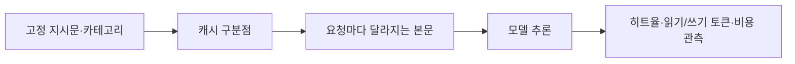

# 모델만 바꿨는데 LLM 비용이 3배가 된 이유

> [!abstract] 한 줄 정리
> LLM 모델의 토큰 단가가 낮아져도 프롬프트 캐시 정책이 바뀌면 요청당 비용은 오히려 급증할 수 있다. 모델 변경은 가격표 비교가 아니라 실제 캐시 히트율과 요청 비용까지 확인하는 운영 변경이다.

> 당근 기술 블로그 · Jaemin Seo(Jay) · 2026-10-21

## 핵심 내용

언어모델의 입력 토큰 가격이 저렴해져도 프롬프트 캐시가 재사용되지 않으면 실제 요청 비용은 커질 수 있다. 당근의 모델 전환 사례에서는 주제 분류 기능이 정상 응답했지만 기존에 쓰던 캐시와 새 모델의 구분점 정책이 달라져 히트율이 급격히 떨어졌다. 기능 테스트의 성공과 단위 요청 비용의 회귀는 서로 다른 문제였다.



*원문에서 확인한 사실을 바탕으로 가로 방향으로 자체 재구성한 개념도다.*

캐시가 재사용되려면 앞부분의 프롬프트가 일치해야 한다. 고정 지시문과 카테고리 정의 뒤에 매 요청 변경되는 글 본문이 붙는 구조에서, 구분점이 가변 본문 뒤에 있으면 사실상 서로 다른 프롬프트를 저장하게 된다. 정적 지시문 뒤에 캐시 경계를 명시하는 방식으로 바꾸고 공통 템플릿에 자동 삽입하도록 만들어 반복 입력을 분리했다.

```text
# 프롬프트의 논리적 배치 (학습용 재구성)
[고정 시스템 지침 + 카테고리 목록]
[반복 접두부 캐시 경계]
[매번 변경되는 기사 본문]
```

경계를 설정하는 실제 API 필드는 공급자·모델별 문서를 확인해야 하며 서로 호환되지 않을 수 있다.

| 확인 단계 | 캐시 히트율 | 요청당 비용과 의미 |
| --- | ---: | --- |
| 기존 모델 사용 | 약 85.8% | 교체 전 기준선 |
| 새 모델로 변경 직후 | 약 2.3% | 단가는 약 20% 낮았으나 요청당 비용 약 3.2배 |
| 캐시 경계 명시 후 | 약 95% | 문제 상태 대비 요청당 비용 약 1/5 |

*원문에서 설명한 약 22% 손익분기점은 해당 요금·캐시 쓰기/읽기 할인 구조를 전제로 계산한 값이며, 모든 모델의 보편적 기준은 아니다.*

원문에서는 기존 히트율 약 85.8%가 모델 교체 후 2.3%로 떨어졌으며, 단가는 약 20% 낮았어도 요청당 비용이 약 3.2배 늘었다. 경계 위치를 바로잡은 뒤 히트율은 약 95%로 회복되고 요청 비용은 문제 상태 대비 약 1/5로 감소했다. 캐시 쓰기와 읽기의 단가, 최소 토큰 길이, TTL은 모델·공급자마다 달라 원문 손익분기점 22%를 일반적인 규칙으로 적용할 수 없다.

## 왜 읽을까

기능 테스트가 모두 성공해도 운영 비용은 실패할 수 있다는 점을 구체적인 숫자로 보여준다. 프롬프트 구조, 모델별 캐시 정책, 토큰 사용량 메타데이터를 배포 검증의 일부로 취급해야 하는 이유를 이해하기 좋다.

**프로젝트에 적용 — DevPedia**

- [ ] 향후 AI 기반 분류 기능을 도입한다면 고정 프롬프트와 가변 입력을 분리한다.
- [ ] 모델 변경 전후 요청당 비용, 캐시 읽기/쓰기 토큰, 히트율, 응답 품질을 함께 기록한다.
- [ ] 캐시 정책·최소 길이·TTL 등은 사용 모델의 최신 문서와 실제 사용량으로 검증한다.
- [ ] 캐시 실패를 API 오류와 별개로 탐지하는 비용 회귀 지표를 정의한다.

---

**원문:** [모델만 바꿨는데 LLM 비용이 3배가 된 이유](https://medium.com/daangn/%EB%AA%A8%EB%8D%B8%EB%A7%8C-%EB%B0%94%EA%BF%A8%EB%8A%94%EB%8D%B0-llm-%EB%B9%84%EC%9A%A9%EC%9D%B4-3%EB%B0%B0%EA%B0%80-%EB%90%9C-%EC%9D%B4%EC%9C%A0-5ae60ab5108b)
