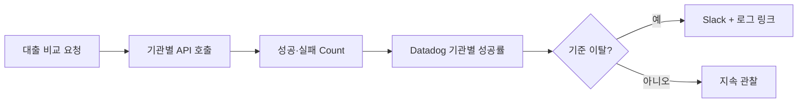

# 100여개의 대출 기관 API, 자동으로 운영하기

> [!abstract] 한 줄 정리
> 외부 API의 성공·실패 횟수를 메트릭으로 집계하는 것만으로는 장애를 놓칠 수 있다. 기관별 성공률을 대시보드와 자동 알림으로 연결해 개발자가 지속적으로 지켜보지 않아도 먼저 대응하는 체계를 구축했다.

> 뱅크샐러드 기술 블로그 · 2024-12-26

## 핵심 내용

대출비교 서비스에서 100여 개 금융기관 API 중 하나가 실패하면 전체 서버가 정상이라도 사용자에게 보여줄 수 있는 대출 조건은 불완전해질 수 있다. 뱅크샐러드는 '전체 서비스가 살아 있는가'보다 기관별 API의 실제 성공·실패를 관찰하기 위해 호출별 Count 메트릭과 Datadog 대시보드를 사용했다.

*원문 사실을 바탕으로 가로 방향으로 자체 재구성한 학습용 흐름도다.*

금융기관을 구분할 수 있는 식별자별로 호출 성공률을 계산해야 전체 평균 뒤에 숨는 개별 장애를 찾을 수 있다. 임계값 아래로 내려가면 Slack으로 알리되 알림에 관련 로그와 대시보드를 함께 넣어 조사로 이어지게 했다. 단, 호출량 0은 기관 점검 시간 또는 사용자의 요청 부재 때문에 생길 수도 있으므로 무조건 실패로 취급하지 않는 조건을 추가했다.

| 관측 기준 | 판단할 내용 |
| --- | --- |
| 기관별 성공률 | 성공한 호출 / 전체 시도 |
| 기관별 호출량 | 점검·무수요와 장애 구분 |
| 알림 내용 | 기관 ID, 오류 유형, 로그·대시보드 링크 |
| 원문 운영 변화 | 약 90% → 약 99% 성공률(5개월 관찰) |

*전체 성공률 개선을 알림 시스템 하나의 독립 효과라고 단정할 수는 없다.*

원문은 약 5개월 전 90% 수준이었던 성공률이 99% 수준으로 높아졌다고 보고한다. 이는 알림 도입과 후속 기관 협의·오류 처리 개선이 함께 이루어진 운영 관찰 결과이므로 알림 시스템 단독의 인과 효과라고 주장할 수는 없다. 외부 의존성의 가용성을 관리할 때에는 표본 수와 정상 무호출, 호출 오류, 사용자의 체감 실패를 분리해야 한다.

## 왜 읽을까

외부 의존성이 많은 서비스에서 '서버가 살아 있다'는 사실보다 파트너별 실제 요청 성공률을 관찰하는 일이 더 중요하다는 판단 기준을 얻을 수 있다. 대시보드 구축에 그치지 않고 알림에 조사 근거를 넣어 실제 대응 흐름을 줄인 점도 참고할 만하다.

**프로젝트에 적용 — PawCycle**

- [ ] 외부 결제·배송·알림 등 실제 연동 지점을 파악해 의존성별 성공·실패 메트릭을 정의한다.
- [ ] 실패율 알림에는 서비스명, 오류 코드, 관련 로그 및 대시보드 위치를 포함한다.
- [ ] 요청이 전혀 없는 정상 시간대와 실제 장애를 구분하는 알림 조건을 설계한다.

---

**원문:** [100여개의 대출 기관 API, 자동으로 운영하기](https://blog.banksalad.com/tech/banksalad-loan-api/)
