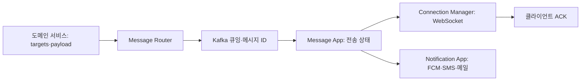

# 독립적이고 범용적인 올인원 메시징 플랫폼

> [!abstract] 한 줄 정리
> 여러 서비스가 중복 구현하던 메시징 기능을 공통 플랫폼으로 분리하되, 수신 대상과 메시지 의미는 호출 서비스가 결정하도록 경계를 설정했습니다. 비동기 전송·수신 확인·오프라인 복구를 별개 책임으로 다룬 설계 사례입니다.

> LINE Engineering · 2023-08-04

## 핵심 내용

LINE의 MessagingHub는 WebSocket 서버 푸시, 앱 푸시, SMS, 이메일과 채팅을 여러 서비스가 중복 구현하지 않도록 전송 경로를 표준화했다. 그렇다고 하나의 중앙 서비스가 모든 도메인에 대한 비즈니스 규칙까지 알아야 하는 것은 아니다. 메시지의 `targets`와 `payload`는 원 서비스를 통해 결정하고 허브는 전달 상태와 채널별 재시도를 담당한다.



*원문 사실을 바탕으로 가로 방향으로 자체 재구성한 학습용 흐름도다.*

Message-router가 요청을 Kafka에 저장하고 메시지 ID를 돌려주면 Message-app이 전달 상태를 관리한다. Connection-manager는 연결된 클라이언트로 서버 푸시를 수행하고 Notification-app은 FCM·SMS·메일 등 연결이 없을 때의 알림 채널을 제공한다. 수신자가 일시적으로 오프라인이라면 미전달 메시지를 보관하거나 재접속할 때 처리해야 한다.

```json
// 허브 호출 계약을 학습용으로 단순화한 예시
{"messageId":"evt-123","targets":["user-42"],"payload":{"type":"approval"}}
```

메시지 내용을 해석하고 누구에게 보내는지 결정하는 책임은 호출 도메인에 남긴다.

| 처리 단계 | 의미 | 미확정인 부분 |
| --- | --- | --- |
| 메시지 ID 발급 | 요청 접수 | 실제 전송·수신 |
| Kafka 큐잉 | 비동기 처리를 위한 저장 | 단말 도착 |
| 서버 푸시 | 연결 대상으로 전달 시도 | 클라이언트 수신 확인 |
| 클라이언트 ACK | 단말의 수신 응답 | 사용자 읽음·업무 완료 |

*원문 보고 당시 피크 동시접속 약 5만, 일일 메시지 150만~200만 건이며 현재 실적은 아니다.*

이때 플랫폼 수락, 큐 저장, 서버 발송, 클라이언트 ACK는 서로 다른 상태다. Kafka에 적재되었다고 사용자가 받았다고 기록하면 중복·유실을 제대로 처리할 수 없다. 원문에 제시된 피크 동시 접속 약 5만 명과 일일 150만~200만 건의 메시지는 해당 발표 시점의 운영 현황으로, 현재의 값이라고 일반화하지 않는다.

## 왜 읽을까

공통 플랫폼의 핵심이 단순 재사용이 아니라 책임 경계와 메시지 전달 보장 수준이라는 사실을 보여 줍니다. Kafka 큐잉 성공, 푸시 요청 성공, 실제 수신 완료가 서로 다른 사건임을 구분하는 사고방식은 이벤트 기반 시스템 설계에 직접 도움이 됩니다.

**프로젝트에 적용 — DevPedia**

- [ ] 모집 승인·지원 상태 변경 알림에서 '상태를 결정하는 도메인'과 '알림을 전송하는 컴포넌트'의 책임을 분리합니다.
- [ ] 알림 이벤트에 고유 ID와 처리 상태를 남기고, 중복 처리·재시도·전송 실패 시의 동작을 설계합니다.
- [ ] 초기 규모에서는 별도 메시징 플랫폼을 구축하지 않고 애플리케이션 내부 경계부터 명확히 하며, 독립 서비스 분리는 필요성이 확인된 뒤 판단합니다.

---

**원문:** [독립적이고 범용적인 올인원 메시징 플랫폼](https://engineering.linecorp.com/ko/blog/independent-universal-all-in-one-messaging-platform/)
