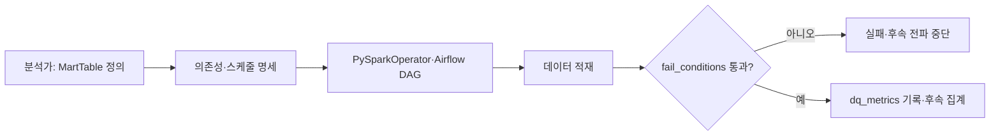

# 데이터 분석가가 직접 정의, 배포, 관리하는 뱅크샐러드 데이터 파이프라인

> [!abstract] 한 줄 정리
> 데이터 엔지니어만 수정할 수 있던 파이프라인을 명세·실행·검증·배포로 추상화해 데이터 분석가가 직접 운영하도록 바꿨습니다. 데이터 품질 실패 조건을 코드로 관리해 잘못된 결과의 전파도 막았습니다.

> 뱅크샐러드 기술 블로그 · 2023-06-05

## 한눈에 보기

데이터 분석가가 테이블 적재를 요청할 때마다 엔지니어가 Spark 작업과 Airflow DAG를 직접 배포하면 요구가 늘수록 전달·대기 비용이 커진다. 뱅크샐러드는 MartTable의 선언과 실행 인프라를 분리하고 데이터 사용자가 로직·스케줄·의존성을 직접 관리하도록 바꾸었다. 핵심은 데이터 품질에 실패 판정을 할 수 있는 계약을 함께 제공했다는 점이다.

*원문에서 제시된 과정을 바탕으로 자체 재구성한 설명용 도식이다.*

`fail_conditions`는 ID 중복·필수값 null처럼 파이프라인을 실패시킬 조건을 코드로 규정한다. `dq_metrics`는 경고와 추세 관찰용이므로 정합성 실패 조건과 다르게 취급한다. 분석가의 자율성을 높이려면 실행 권한뿐 아니라 검증 가능하고 복구 가능한 인터페이스가 필요하다.

## 핵심 내용

### 배경과 문제

**문제:** 데이터 분석가의 신규 테이블 적재 요청마다 데이터 엔지니어가 Spark 작업과 Airflow DAG를 직접 작성·배포해야 해 팀 병목이 생겼습니다.

### 구조와 설계 선택

**구조:** datapipe의 MartTable 명세와 DAG 의존성 선언, PySparkOperator로 실행 인프라를 숨기고 데이터 사용자가 로직·스케줄·의존성에 집중하게 했습니다.

**검증:** fail_conditions는 null·중복 등 핵심 정합성 위반 시 적재를 실패시키고, dq_metrics는 경고 지표를 보고합니다. 사용자 인덱스 중복을 차단해 하위 파이프라인 오염을 막은 사례가 있습니다.

### 결과와 제약

**운영:** GitHub/Slack 기반 공통 배포 흐름과 Airflow 동기화를 연결해 분석가가 직접 배포·실행하도록 했습니다.

**수치:** 데이터 엔지니어가 아닌 직군의 파이프라인 개발·수정·배포 사례가 연간 600건으로 이전 대비 6배 이상 증가했습니다.

### 핵심 수치·비교

| 계약 | 분석가의 입력 | 플랫폼의 보장 |
| --- | --- | --- |
| MartTable | 계산·적재 규칙 | 실행 단위 제공 |
| DAG 의존성 | 선행 작업과 스케줄 | 실행 순서 제어 |
| fail_conditions | 치명적 품질 위반 | 실패로 처리해 하위 오염 방지 |
| dq_metrics | 관찰할 품질 지표 | 추세·경고 기록 |

*원문에 따르면 비데이터 엔지니어 직군의 연간 작업은 약 600건으로 이전의 6배 이상이었다.*

## 왜 읽을까

내부 플랫폼 설계에서 사용자가 알아야 할 개념과 플랫폼이 숨겨야 할 인프라를 구분하는 방법을 보여줍니다. 특히 데이터 정합성 검증을 실행 후 수동 확인이 아니라 파이프라인의 배포 가능한 계약으로 취급한 점이 유용합니다.

**프로젝트에 적용 — PawCycle**

- [ ] 주문·재고 집계 배치가 있다면 입력 스키마와 선행 작업 의존성을 선언합니다.
- [ ] ID 중복, 필수값 null, 비어 있는 결과를 실패 조건으로 정의합니다.
- [ ] 정합성 실패 시 후속 집계를 중단하고 알림에 원인과 영향 범위를 기록합니다.

---

**원문:** [데이터 분석가가 직접 정의, 배포, 관리하는 뱅크샐러드 데이터 파이프라인](https://blog.banksalad.com/tech/datapipe/)
