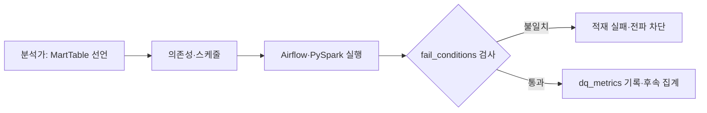

# 데이터 분석가가 직접 정의, 배포, 관리하는 뱅크샐러드 데이터 파이프라인

> [!abstract] 한 줄 정리
> 데이터 엔지니어만 수정할 수 있던 파이프라인을 명세·실행·검증·배포로 추상화해 데이터 분석가가 직접 운영하도록 바꿨습니다. 데이터 품질 실패 조건을 코드로 관리해 잘못된 결과의 전파도 막았습니다.

> 뱅크샐러드 기술 블로그 · 2023-06-05

## 핵심 내용

뱅크샐러드의 분석가가 새 데이터 마트 테이블을 요청할 때마다 데이터 엔지니어가 Spark 작업을 작성하고 Airflow DAG에 연결한다면, 파이프라인 자체의 기능보다 팀 간 작업 대기와 배포가 병목이 된다. 이를 해결하려고 데이터 사용자는 무엇을 계산할지 선언하고 플랫폼은 어떻게 실행·배포할지를 담당하도록 경계를 분리했다.



*원문 사실을 바탕으로 가로 방향으로 자체 재구성한 학습용 흐름도다.*

원문의 `MartTable`은 데이터베이스·테이블명·DDL·PySpark 작업의 경로, 스케줄과 선행 작업을 묶는 선언이다. 실제 DAG는 선행 테이블의 일간/시간별 센서나 같은 DAG 내부 의존성을 연결해 빌드된다. 코드 작성자가 Airflow Operator 구현과 인프라를 모두 알 필요 없이 테이블 계약과 데이터 관계에 집중할 수 있도록 추상화한 것이다.

```python
# 원문 MartTable 명세의 핵심 필드만 축약한 학습 예시
user_index = MartTable(
    dag_id="core_analysis_dag",
    table_name="s_user_index",
    pyspark_job_path="sql.core_user.s_user_index_dml",
)
```

핵심은 분석가가 데이터 계약을 선언할 수 있는 DSL과 실행 인프라의 책임을 분리한 점이다.

| 계약 | 분석가의 입력 | 플랫폼의 보장 |
| --- | --- | --- |
| MartTable | 계산·적재 규칙 | 실행 단위 제공 |
| DAG 의존성 | 선행 작업과 스케줄 | 실행 순서 제어 |
| fail_conditions | 치명적 품질 위반 | 실패로 처리해 하위 오염 방지 |
| dq_metrics | 관찰할 품질 지표 | 추세·경고 기록 |

*원문에 따르면 비데이터 엔지니어 직군의 연간 작업은 약 600건으로 이전의 6배 이상이었다.*

품질 검증에서는 `fail_conditions`와 `dq_metrics`를 나눈다. 예를 들어 사용자 인덱스의 ID 중복이나 필수 키 누락은 후속 분석 전체를 오염시킬 수 있으므로 적재를 실패시키고, 연령 값의 null 비율 등은 우선 지표로 보고할 수 있다. 명세와 검증 규칙을 PR에서 리뷰할 수 있게 한 것도 중요하다. 원문은 데이터 엔지니어가 아닌 직군의 파이프라인 개발·수정·배포가 연간 약 600건으로 증가했다고 보고한다.

## 왜 읽을까

내부 플랫폼 설계에서 사용자가 알아야 할 개념과 플랫폼이 숨겨야 할 인프라를 구분하는 방법을 보여줍니다. 특히 데이터 정합성 검증을 실행 후 수동 확인이 아니라 파이프라인의 배포 가능한 계약으로 취급한 점이 유용합니다.

**프로젝트에 적용 — PawCycle**

- [ ] 주문·재고 집계 배치가 있다면 입력 스키마와 선행 작업 의존성을 선언합니다.
- [ ] ID 중복, 필수값 null, 비어 있는 결과를 실패 조건으로 정의합니다.
- [ ] 정합성 실패 시 후속 집계를 중단하고 알림에 원인과 영향 범위를 기록합니다.

---

**원문:** [데이터 분석가가 직접 정의, 배포, 관리하는 뱅크샐러드 데이터 파이프라인](https://blog.banksalad.com/tech/datapipe/)
