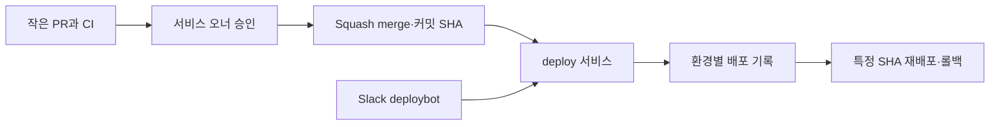

# 하루에 1000번 배포하는 조직 되기

> [!abstract] 한 줄 정리
> 복잡한 Git-Flow와 태그 기반 배포를 단순화하고 커밋 단위 배포·롤백을 가능한 ChatOps로 전환했습니다. 목표는 배포 횟수 자체보다 변경의 추적성과 복구 가능성을 높이는 것이었습니다.

> 뱅크샐러드 기술 블로그 · 2020-02-29

## 한눈에 보기

하루 1,000번 배포라는 제목은 달성 건수를 말하기보다 작은 변경을 안전하게 빠르게 출시하려는 방향을 드러낸다. 뱅크샐러드는 Git-Flow에서 브랜치와 태그를 여러 번 옮기는 비용을 줄이고, 커밋 SHA를 배포 가능한 단위로 삼았다. 승인·빌드·실제 배포·사용자 노출을 한 사건으로 보지 않고 분리한 점이 실무적이다.

*원문 내용을 바탕으로 자체 재구성한 개략 흐름도다.*

Slack의 명령 인터페이스와 배포 실행 서비스가 분리되어 있어 사용자는 환경과 SHA를 지정하고 실행 결과를 추적할 수 있다. 단순한 '배포 시작' 버튼보다 누가 어떤 SHA를 어떤 환경에 적용했으며 이전 상태로 어떻게 되돌리는지 기록하는 구조가 중요하다. 배포 빈도가 늘어도 기능 노출은 점진적 롤아웃과 운영 지표를 따로 확인해야 한다.

## 핵심 내용

### 문제와 제약

**문제:** develop·release·master를 오가는 Git-Flow와 태그 배포는 절차가 길고, 이전 커밋으로 되돌리려면 별도 롤백 브랜치가 필요했습니다.

### 설계 선택과 실제 구현

**접근:** master 기반의 작은 PR, CI 및 서비스 오너 승인, Squash and merge를 도입해 배포 가능한 변경 단위를 명확히 했습니다.

**구조:** 배포 실행 서비스 deploy와 Slack 인터페이스 deploybot을 분리하고, 커밋 SHA별 배포 상태·환경·이력을 조회하거나 특정 커밋을 재배포하도록 구성했습니다.

### 결과·한계·운영 판단

**수치:** 배포 단계 수를 60~83% 줄였고 배포 건수는 이전 대비 약 4배로 증가했습니다. 제목의 하루 1,000번은 달성 실적이 아닌 지향 목표입니다.

**트레이드오프:** GitHub API·가용성에 강하게 의존했고, 빈번한 배포와 실제 사용자 노출을 분리해 점진적 rollout과 관측으로 안정성을 관리했습니다.

### 주요 비교와 확인 기준

| 변경 전 | 변경 후 | 검증 근거 |
| --- | --- | --- |
| Git-Flow 여러 브랜치·태그 단위 배포 | 작은 PR, 커밋 SHA 단위 배포 | 절차 단계 수 60~83% 감소 |
| 롤백 전용 브랜치와 별도 절차 | 이전 정상 커밋 재배포 | 복구 경로 단순화 |
| 명령·상태가 여러 곳에 분산 | deploy / deploybot와 이력 추적 | 배포 건수 이전 대비 약 4배 |

*당시 실제 하루 1,000번을 달성했다는 주장과는 구분해야 한다.*

## 왜 읽을까

배포 자동화는 버튼 하나를 만드는 작업이 아니라 커밋 식별, 승인, 추적, 롤백과 사용자 노출을 별도 단계로 설계하는 일임을 보여줍니다. 2020년의 도구 선택은 낡았어도 변경 단위와 복구 경계를 설계하는 원칙은 여전히 유효합니다.

**프로젝트에 적용 — PawCycle**

- [ ] 현재 운영 배포 SHA·이미지 버전·환경을 조회할 수 있는지 확인합니다.
- [ ] CI 통과와 배포 완료, 실제 사용자 노출을 별도 상태로 기록합니다.
- [ ] 이전 정상 SHA로 되돌리는 복구 절차를 운영 변경 없이 격리 환경에서 검증합니다.

---

**원문:** [하루에 1000번 배포하는 조직 되기](https://blog.banksalad.com/tech/become-an-organization-that-deploys-1000-times-a-day/)
