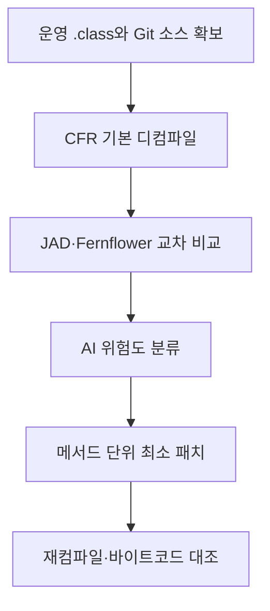

# Java 디컴파일러로 운영 서버와 형상관리 소스의 불일치를 해소하다

> [!abstract] 한 줄 정리
> 운영 바이너리와 Git 소스가 어긋났을 때 AI가 추정한 코드를 그대로 복사하면 위험합니다. 디컴파일 결과를 교차 비교하고 최소 수정 후 재컴파일 결과로 확인하는 검증 루프가 필요합니다.

> 올리브영 테크블로그 · 2026-09-30

## 한눈에 보기

배포된 Java 클래스가 Git 소스와 다르면 '운영에서 실행 중인 정확한 코드'라는 기본 전제가 무너진다. 이 사례에서는 ANT 증분 배포 누락과 SFTP 직접 수정으로 운영 파일이 형상관리에서 이탈했다. 디컴파일은 소스 복원의 단서일 뿐이며 컴파일러가 제거한 주석·변수명을 원상 복구할 수 없는 한계도 함께 검증해야 한다.

*원문 기술 내용을 바탕으로 재구성한 학습용 개략도이며 원문 그림 자체가 아니다.*

운영 클래스의 디컴파일 결과와 형상관리 소스를 그대로 diff하면 디컴파일러가 재구성한 문법 차이를 실제 변경으로 오판할 수 있다. 따라서 서로 다른 도구로 교차 검증한 뒤 메서드 수준만 수정하고, **패치 소스를 다시 컴파일한 결과**로 최종 확인해야 한다. AI는 차이 분류의 보조 도구이며 변경 승인자는 엔지니어다.

## 핵심 내용

### 문제와 제약

**문제:** 10년 된 백오피스에서 ANT 증분 배포 누락과 SFTP 직접 수정으로 운영 .class와 형상관리 소스가 달라졌습니다. 약 1,300개 화면, FE 파일 4,800개, WAS 파일 1,000개 규모였습니다.

### 선택한 구조와 구현

**시행착오:** 디컴파일 소스로 전부 덮어쓰는 1차 시도는 주석·변수명 손실 때문에 중단했고, 2차에서는 JAD와 CFR의 추론 방식 차이로 거짓 diff가 대량 발생했습니다.

**접근:** CFR을 기본으로 JAD·Fernflower를 교차 검토하고, AI로 차이를 상·중·하 위험도로 분류한 뒤 엔지니어가 메서드 단위 최소 패치를 적용했습니다.

### 검증 결과와 남은 판단

**검증:** 수정한 소스를 재컴파일하여 운영 .class와 비교했습니다. WAS 파일 약 10%, FE 파일 약 20%에서 불일치를 발견했고, 최종 99% 일치 및 나머지의 로직·바이트코드 동일성을 확인했습니다.

**주의점:** AI는 차이 분석과 우선순위화에 사용하고 실제 반영은 사람이 결정했습니다. 운영 직접 수정 경로를 막고 배포·형상 일치 검증을 지속해야 재발을 방지할 수 있습니다.

### 핵심 근거와 비교

| 시도 | 접근 | 판단 |
| --- | --- | --- |
| 1차 | 디컴파일 코드를 전량 덮어쓰기 | 주석·가독성 손실로 중단 |
| 2차 | JAD 대신 CFR 사용·소스 diff | 디컴파일 추론 차이로 거짓 양성 증가 |
| 3차 | 다중 디컴파일러 교차 검증·최소 수정 | 재컴파일과 바이트코드 비교로 검증 |

*원문은 최종 약 99% 일치 및 나머지 코드의 논리·바이트코드 동등성을 보고한다.*

## 왜 읽을까

리버스 엔지니어링에서 '그럴듯한 코드 복원'과 '실행 동작의 증거 확보'를 구분하는 좋은 사례입니다. AI 분석 결과를 다시 컴파일·비교로 검증하고, 도구의 한계까지 의심하는 절차를 배울 수 있습니다.

**프로젝트에 적용 — PawCycle**

- [ ] 현재 배포 SHA·컨테이너 이미지·실행 JAR의 대응 관계를 확인합니다.
- [ ] 설계 역추적 시 AI가 추론한 책임·흐름을 테스트와 실제 코드 증거로 대조합니다.
- [ ] 릴리스 후 소스/아티팩트 불일치를 감지할 체크를 배포 검증에 추가합니다.

---

**원문:** [Java 디컴파일러로 운영 서버와 형상관리 소스의 불일치를 해소하다](https://www.oliveyoung.tech/2026-09-30/decompiler_ai/)
