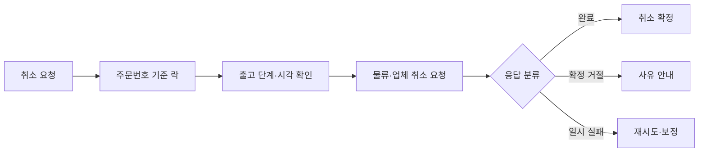

# 고객의 취소할 권리를 보장하다

> [!abstract] 한 줄 정리
> 사용자에게 주문 취소를 즉시 확정해 주려면 상태 판단뿐 아니라 외부 시스템의 비가역 호출, 이벤트 누락, 동시 요청, 재시도를 함께 설계해야 합니다.

> 올리브영 테크블로그 · 2026-09-23

## 핵심 내용

- **문제:** 기존에는 실제 출고보다 훨씬 이른 '출하 지시' 단계에서 취소를 막았습니다. 센터배송·업체배송·오늘드림별로 피킹 완료·송장 등록·배차 시점까지 취소 가능 구간을 확대했습니다. - **구조:** 주문서·마이페이지·백오피스·배치에 흩어진 취소 판단을 '취소 불가 일시' 하나로 통합하고, Kafka 피킹 완료 이벤트를 새로 연결했습니다. - **동시성:** 배차와 취소가 동시에 발생할 때 외부 API 호출을 DB 락 안에 두지 않도록 주문번호 단위 Redis 분산 락을 채택했습니다. 낙관적 락은 이미 나간 외부 호출을 되돌릴 수 없어 부적합했습니다.

- **장애 대응:** 누락된 피킹 이벤트를 출고 확정 신호로 보완하고, 외부 업체 응답을 완료·확정 거절·일시 실패로 정규화했습니다. 서킷 브레이커와 SQS 재시도·보정 배치로 외부 장애를 격리했습니다. - **결과:** 배송 준비 중 취소 관련 고객 문의는 평시 약 90%, 세일 기간 약 89% 감소했습니다. 즉시 확정을 약속한 대신 시스템이 후속 처리의 불확실성을 부담합니다.

취소 정책의 핵심은 어떤 화면에서 버튼을 숨기는지보다 **실제 출고 절차와 고객의 취소 요청이 경쟁할 때 무엇을 확정할 수 있는가**에 있다. 기존에는 출하 지시 이후 일률적으로 차단했던 취소를 피킹·송장·배차 단계까지 허용하면서, 주문서·운영 화면·배치의 판단 기준을 취소 불가 일시로 통합했다.

*자체 재구성. 실제 업무의 모든 상태를 표현한 완전한 도식은 아니다.*

외부 API를 DB 락 안에서 기다리면 경합이 DB로 전파될 수 있다. Redis 분산 락도 만료·장애 가능성이 있어 DB 원자적 상태 변경과 멱등한 재처리를 함께 고려해야 한다. 고객 문의 약 90% 감소는 이 개편 이후의 관측치다.

## 왜 읽을까

'취소 버튼 하나'가 도메인 불변식, 메시지 전달, 동시성 제어, 장애 격리로 이어지는 전 과정을 볼 수 있습니다. 비관적·낙관적·분산 락 중 어떤 방법을 선택할지, 특히 외부 API의 되돌릴 수 없는 부작용을 기준으로 판단하는 대목이 유익합니다.

**프로젝트에 적용 — PawCycle**

- [ ] 주문 취소 가능 시점과 결제·재고·배송의 비가역 경계를 상태 전이표로 작성합니다.
- [ ] 취소와 출고 요청의 동시 실행·이벤트 지연·중복 수신 테스트를 만듭니다.
- [ ] 외부 취소 API 실패 시 재시도·멱등성·보정 작업의 책임을 정의합니다.

---

**원문:** [고객의 취소할 권리를 보장하다](https://www.oliveyoung.tech/2026-09-23/order-cancellation-shipping-ready/)
