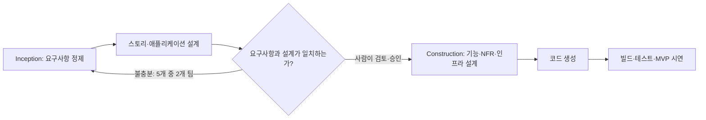

# AI와 협업하는 새로운 개발 프로세스, 올리브영은 어떻게 시작했을까 (feat. AI-DLC)

> [!abstract] 한 줄 정리
> AI를 코드 생성기처럼 사용하는 것만으로는 팀 전체의 개발 생산성과 품질을 보장할 수 없다. 올리브영은 요구사항 분석부터 설계, 구현, 테스트까지 사람의 승인과 구조화된 산출물을 연결하는 AI-DLC 워크숍을 실험했고, 모호한 요구사항이 후속 단계를 다시 수행하게 만드는 핵심 병목임을 확인했다.

## 한눈에 보기

*그림 1. AI-DLC Core Framework의 단계별 역할과 순환 구조 — [출처: 올리브영 테크블로그](https://www.oliveyoung.tech/2026-04-16/oliveyoung-tech-ai-dlc-workshop/)*

원문 그림은 Inception·Construction·Operation을 연결하지만, 이번 3일 실험에서 중점적으로 다룬 구간은 요구사항 정제부터 테스트·시연까지다. 단계가 빠르게 이어지는 만큼 다음 단계의 입력이 될 요구사항과 설계 산출물을 먼저 검증해야 한다.

*자체 재구성 도식. 원문 워크숍에서 확인된 요구사항 재정제 사례를 강조한 흐름이며, AWS 방법론 전체를 그대로 재현한 것은 아니다.*

## 핵심 내용

### 적용 배경과 실험 범위

올리브영은 AI 도입이 개인의 빠른 코딩에 머물지 않고 조직 차원의 일관된 개발 프로세스가 되려면 무엇이 필요한지 검증하고자 했다. 2026년 3월 AWS의 AI-DLC(AI-Driven Development Lifecycle) 방식으로 Unicorn Gym이라는 3일 워크숍을 운영했으며, 30여 명이 참여해 실제 사업 과제 약 20개 중 선정한 5개를 다뤘다. 신규 개발(Greenfield)과 기존 시스템 현대화(Brownfield)를 함께 포함해, 새 서비스 구축과 레거시 분석에서 AI의 활용 범위를 비교할 수 있게 구성했다.

### 요구사항 정제와 설계 리뷰

첫날의 Inception Phase에서 팀은 Kiro의 Steering 파일에 작업 규칙을 정의하고, `requirements.md`를 기반으로 모호한 요구사항을 질문으로 구체화했다. 이후 사용자 스토리와 애플리케이션 구조의 초안을 AI와 함께 만들되, 비즈니스 규칙과 의존성은 사람이 검토해 조정했다. Brownfield 팀은 기존 코드를 역공학해 동작을 문서화하고 난이도별 화면을 분류했다. 핵심은 코드를 즉시 생성하는 것이 아니라, 다음 단계가 사용할 입력을 검토 가능한 산출물로 만드는 절차였다.

### 되돌림이 발생한 Construction 단계

둘째 날 Construction Phase에서는 기능 설계(데이터 모델·비즈니스 로직·API), 비기능 요구사항(성능·보안·확장성), 인프라 설계, 코드 생성으로 이어졌다. **5개 팀 중 2개 팀은 요구사항이 충분히 정제되지 않아 Inception으로 돌아가야 했다.** AI가 제안한 설계가 요구와 어긋났기 때문이다. AI가 제시한 NFR 목표 수치도 그대로 확정하는 것이 아니라 현재 과제의 규모와 위험에 맞는지 사람이 판단해야 한다는 점이 드러났다. 마지막 날에는 빌드·테스트와 MVP 시연을 수행했으며, 5개 팀 모두 과정을 완주했지만 완성도는 달랐다.

### 검증 결과와 남은 과제

레거시 현대화 과제는 기존 구현과 동일한 테스트 결과가 나오는지를 전환 성공 기준으로 사용했다. 역공학을 통해 초기에 코드를 이해하고 문서화하는 부담을 줄였으며, 수작업 대비 전환 공수를 줄일 가능성을 확인했지만 **정량적인 절감률은 후속 검증 중**이라고 명시했다. 또 AI가 대량 생성한 설계 문서의 버전 관리, 과도한 아키텍처 제안, 길어진 컨텍스트의 압축과 전달 등은 해결하지 못한 과제로 남았다. 이는 3일간의 워크숍 결과이지, 5개 과제가 모두 운영에 배포되어 성능을 검증했다는 뜻은 아니다.

*그림 2. 올리브영 워크숍의 핵심 레슨런 정리 — [출처: 올리브영 테크블로그](https://www.oliveyoung.tech/2026-04-16/oliveyoung-tech-ai-dlc-workshop/)*

사진이나 장식이 아닌 원문의 요약 그림을 배치했다. 이 그림에서 특히 살펴볼 것은 AI가 빠르게 제안한 설계의 적합성을 사람이 검토하고, Brownfield 과제에서는 이전 동작과의 동등성을 테스트로 판단해야 한다는 점이다.

## 왜 읽을까

AI 활용 개발의 핵심은 프롬프트를 길게 쓰거나 코드 생성량을 늘리는 데 있지 않다. 요구사항의 불확실성을 먼저 줄이고, 도메인 규칙·API 계약·비기능 조건을 사람이 승인한 다음, 테스트 가능한 결과로 연결하는 프로세스가 더 중요하다. 특히 Brownfield에서는 '기존과 동일하게 동작함'을 입증하는 회귀 테스트가 없으면 리팩터링 성공 여부를 판단하기 어렵다.

**DevPedia 적용 아이디어(제안·미검증):** 모집·지원·승인 기능 하나를 선택해 요구사항 → 상태 전이와 불변식 → API/DB 계약 → 구현 → 통합 테스트 순서로 산출물을 만들고, 각 단계마다 변경 승인 기준을 명시해 볼 수 있다. AI가 제안하는 불필요한 인프라·분산 설계는 현재 요구사항과 비교해 채택 또는 기각 근거를 남기는 방식으로 검증한다.

---

**원문:** [AI와 협업하는 새로운 개발 프로세스, 올리브영은 어떻게 시작했을까 (feat. AI-DLC)](https://www.oliveyoung.tech/2026-04-16/oliveyoung-tech-ai-dlc-workshop/)
