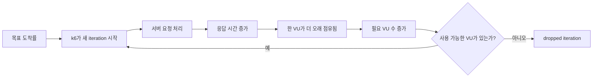
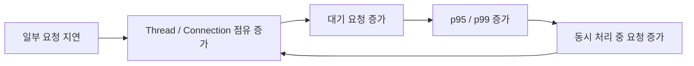

# 단계적 부하 증가와 처리 용량 경계 판정

성능 테스트에서 자주 받는 질문은 “이 서버는 최대 몇 RPS까지 버티나요?”다. 하지만 실제로 중요한 질문은 숫자 하나를 맞히는 것이 아니다. **부하를 올렸을 때 어느 지점부터 사용자 결과가 무너지기 시작하고, 그때 내부의 어떤 대기열과 자원이 먼저 압박받는지 설명할 수 있어야 한다.**

이 글에서는 작은 부하에서 시작해 `25 → 50 → 100 → 150 → ...`처럼 단계적으로 요청률을 높이는 이유, 목표 RPS와 실제 처리량의 차이, k6의 누락된 반복 실행(dropped iteration)이 무엇을 뜻하는지, p50은 정상인데 p95·p99만 급격히 나빠지는 상황을 어떻게 해석하는지, 그리고 언제 다음 부하로 진행하고 언제 멈춰서 원인을 분석해야 하는지를 연결해서 설명한다.

기존 문서에서 이미 자세히 설명한 개념은 반복하지 않는다. Tomcat·HikariCP·DB 대기 구조는 [[06. Tomcat HikariCP DB Queueing]], p50·p95·p99 자체의 의미는 [[07. Latency Percentile과 Tail Latency]], 재현 가능한 Source·Dataset·Runtime 고정은 [[13. 재현 가능한 성능 실험과 안전한 격리]]와 함께 읽으면 된다.

## 1. 왜 한 번에 최대 부하를 넣지 않고 단계적으로 올리는가

처리 용량 경계(Capacity Boundary)는 “150 RPS에서 실패했으니 최대 성능은 149 RPS”처럼 한 숫자로 바로 정해지는 값이 아니다. 성능 결과는 Dataset, 요청 종류, 애플리케이션 버전, JVM, Thread Pool, Connection Pool, DB 상태, 캐시 상태, 같은 Host의 다른 작업 등 여러 조건에 영향을 받는다.

그래서 먼저 조건을 고정한 뒤 **요청 부하만 하나의 독립 변수처럼 올린다.**

```text
Dataset      고정
Source       고정
Runtime      고정
JVM / DB     고정
Workload     고정
Warm-up      고정
측정 시간    고정
Observability 고정

25 RPS
  ↓
50 RPS
  ↓
100 RPS
  ↓
150 RPS
```

이렇게 하면 100 RPS와 150 RPS 사이에서 결과가 크게 달라졌을 때 “데이터가 늘어서 느려진 것인지”, “코드가 바뀌어서 느려진 것인지”를 먼저 의심할 필요가 없다. **부하 증가 자체가 시스템 내부 대기 구조를 어떻게 바꿨는지**에 집중할 수 있다.

단계 간격은 절대적인 규칙이 아니다. 초반에는 두 배씩 넓게 올리다가 이상 신호가 나타나면 간격을 좁힐 수도 있다. 예를 들어 100 RPS는 안정적이고 150 RPS는 실패했다면 실제 처리 용량 경계는 그 사이에 있을 가능성이 있다. 이때 중요한 것은 125 RPS를 바로 찾아 “정답 숫자”를 만드는 것보다, **150에서 왜 실패했는지 먼저 설명하는 것**이다.

## 2. 목표 RPS와 실제 처리량은 같은 숫자가 아니다

부하 테스트 도구에 `rate: 100`을 설정했다고 해서 서버가 실제로 100 RPS를 처리했다는 뜻은 아니다.

k6의 `constant-arrival-rate` 실행기는 열린 부하 모델(Open Model)이다. 서버의 응답이 느려져도 가능한 한 설정된 비율로 새로운 반복 실행(iteration)을 시작하려고 한다. 각 반복 실행이 HTTP 요청 하나를 만든다면 목표 iteration rate를 목표 RPS처럼 사용할 수 있지만, **실제 시작된 반복 실행과 실제 완료된 요청 수는 반드시 결과에서 확인해야 한다.**

Grafana k6 공식 문서는 `constant-arrival-rate`가 응답 시간과 독립적으로 일정한 iteration 시작률을 만들려고 하며, 이를 유지하기 위해 필요한 VU 수를 조절한다고 설명한다.

- [Grafana k6 - Constant arrival rate](https://grafana.com/docs/k6/latest/using-k6/scenarios/executors/constant-arrival-rate/)
- [Grafana k6 - API load testing](https://grafana.com/docs/k6/latest/testing-guides/api-load-testing/)

예를 들어 다음 결과를 보자.

```text
Target RPS  = 150
Actual RPS  = 149.2
Errors      = 0
Dropped     = 34
```

HTTP 응답 오류가 0이라고 해서 “150 RPS를 성공적으로 처리했다”고 말할 수 없다. 일정 수의 반복 실행이 아예 시작되지 못했고 실제 처리량도 목표보다 낮아졌기 때문이다.

따라서 사용자 관점 결과는 최소한 다음을 함께 본다.

| 지표 | 확인하는 질문 |
| --- | --- |
| Target RPS | 우리가 얼마나 요청하려 했는가 |
| Actual RPS | 실제로 얼마나 처리했는가 |
| Error / Timeout | 시작한 요청이 정상 응답했는가 |
| Dropped iteration | 시작해야 했지만 시작하지 못한 작업이 있는가 |
| p50 / p95 / p99 / max | 완료된 요청의 지연 분포는 어떤가 |

## 3. 열린 부하 모델이 중요한 이유: 느려진 서버를 부하가 자동으로 봐주지 않는다

닫힌 부하 모델(Closed Model)에서는 일정 수의 VU가 요청을 보내고 응답을 기다린 다음 다음 요청을 보낸다. 서버가 느려지면 VU도 오래 기다리므로 자연스럽게 새로운 요청 시작률이 줄어든다.

이 구조는 실제 사용자 세션을 모델링할 때 유용할 수 있지만, “초당 150개의 요청이 계속 들어오면 어떻게 되는가?”를 확인하려는 실험에서는 문제가 될 수 있다. 서버가 느려졌기 때문에 부하 생성기도 함께 천천히 요청을 보내면, 서버가 과부하되는 순간을 실제보다 부드럽게 만들 수 있기 때문이다.

k6 문서에서는 이를 coordinated omission과 연결해 설명하고, arrival-rate 실행기를 이용한 Open Model이 요청 시작률을 응답 시간과 분리한다고 설명한다.

- [Grafana k6 - Open and closed models](https://grafana.com/docs/k6/latest/using-k6/scenarios/concepts/open-vs-closed/)



이 흐름 때문에 Open Model에서 `active VUs`가 갑자기 증가하는 현상은 단순히 “사용자가 많아졌다”는 뜻이 아니다. **각 iteration이 오래 걸려 기존 VU가 반환되지 않으므로 목표 도착률을 유지하기 위해 더 많은 VU가 필요해졌을 가능성**도 있다.

## 4. dropped iteration은 실패 신호지만 원인은 하나가 아니다

`dropped_iterations`는 k6가 예정했던 iteration을 시작하지 못한 횟수다. arrival-rate 실행기에서는 보통 **그 시점에 사용할 수 있는 VU가 없을 때** 증가한다.

Grafana 공식 문서는 원인을 크게 두 가지로 나눈다.

1. 실행기 설정이 부족한 경우
2. 시스템이 느려져 iteration이 오래 걸리고 필요한 VU 수가 증가한 경우

- [Grafana k6 - Dropped iterations](https://grafana.com/docs/k6/latest/using-k6/scenarios/concepts/dropped-iterations/)
- [Grafana k6 - Arrival-rate VU allocation](https://grafana.com/docs/k6/latest/using-k6/scenarios/concepts/arrival-rate-vu-allocation/)

따라서 dropped가 한 건이라도 발생했다고 곧바로 “서버 병목”이라고 단정하면 안 된다.

### 부하 생성기 설정 문제일 수 있는 경우

테스트 초반부터 dropped가 발생하고, 서버의 CPU·Thread·Connection·DB 지표는 매우 여유로운데 `preAllocatedVUs` 또는 `maxVUs`가 낮다면 부하 생성기 쪽 설정을 먼저 의심할 수 있다.

```text
서버 응답 정상
내부 Queue 없음
CPU 여유
DB 여유
그런데 maxVUs 도달
→ Load Generator 설정 후보
```

### 시스템 성능 저하일 수 있는 경우

초반에는 목표 도착률을 잘 유지하다가 부하가 높아질수록 응답 시간이 늘고, active VUs가 증가하며, 동시에 Hikari pending·Thread busy·DB wait 같은 지표가 같이 나빠진다면 시스템 내부 병목 가능성이 커진다.

```text
응답 시간 증가
→ VU가 오래 점유됨
→ active VUs 증가
→ 더 이상 여유 VU가 없음
→ dropped iteration
```

즉 `dropped_iterations`는 **최종 판정 지표**이지 단독 Root Cause 지표가 아니다.

## 5. p50은 정상인데 p95·p99만 무너지는 이유

성능이 나빠질 때 모든 요청이 동시에 같은 비율로 느려지는 것은 아니다.

예를 들어 다음 패턴은 매우 중요하다.

```text
25 RPS   p50 90ms   p95 130ms   p99 210ms
50 RPS   p50 80ms   p95 150ms   p99 340ms
100 RPS  p50 70ms   p95 160ms   p99 640ms
150 RPS  p50 70ms   p95 1.2s    p99 1.9s
```

p50이 거의 변하지 않는다는 것은 **절반 정도의 요청은 여전히 평소처럼 처리되고 있다는 뜻**이다. 반면 p95와 p99가 크게 증가하면 일부 요청이 특정 대기열이나 경쟁 조건에 들어가면서 오래 기다리기 시작했을 수 있다.

Google의 *The Tail at Scale*은 시스템 규모나 이용률이 커질수록 일시적인 지연이 전체 서비스의 꼬리 지연에 큰 영향을 줄 수 있다고 설명한다. 이 글은 분산 시스템을 중심으로 하지만, “평균이나 중앙값은 멀쩡한데 일부 느린 요청이 사용자 경험과 전체 용량을 지배할 수 있다”는 관점은 단일 Spring Boot 서비스에서도 유용하다.

- [Google Research - The Tail at Scale](https://research.google/pubs/the-tail-at-scale/)

꼬리 지연은 그 자체로 끝나지 않는다. Blocking I/O 기반 서버에서는 느린 요청이 Thread와 Connection을 더 오래 점유한다. 그러면 다음 요청이 기다릴 가능성이 커지고, 다시 더 긴 응답 시간이 만들어지는 양의 피드백이 생길 수 있다.



Google SRE의 overload 문서도 과부하 시 요청이 쌓이고 높은 지연과 자원 경쟁이 서로를 악화시킬 수 있음을 설명하며, Queue 길이를 무한히 늘리는 것보다 시스템이 감당할 수 있는 일을 명확하게 제한하는 것이 중요하다고 설명한다.

- [Google SRE - Handling Overload](https://sre.google/sre-book/handling-overload/)
- [Google SRE - Addressing Cascading Failures](https://sre.google/sre-book/addressing-cascading-failures/)

## 6. 처리 용량 경계는 한 지표가 아니라 여러 신호가 함께 만드는 구간이다

처리 용량 경계를 찾을 때는 “CPU 80%” 같은 단일 숫자를 기준으로 삼지 않는다. 시스템마다 먼저 포화되는 자원이 다르기 때문이다.

### 강한 실패 신호

다음은 다음 부하 단계로 그대로 진행하기보다 멈춰서 분석할 근거가 된다.

- 목표 처리량을 지속적으로 따라가지 못함
- `dropped_iterations`가 기준을 넘음
- HTTP 오류 또는 Timeout 발생
- p95·p99가 이전 단계 대비 비선형적으로 증가
- Hikari pending, Tomcat queue, Lock wait 같은 실제 대기열이 반복적으로 나타남
- Container restart, OOMKilled 같은 안정성 실패 발생

### 주의해서 추적할 신호

다음은 한 번 발생했다고 바로 실패로 확정하지 않는다.

- Hikari active가 한 번 maximumPoolSize에 도달
- pending이 한 샘플에서 잠깐 발생
- p99 한 번 상승
- 순간 CPU peak
- 단일 GC pause spike

이런 값은 다음 부하 단계에서도 같은 방향으로 반복되는지 확인해야 한다.

예를 들어 `pending > 0`이 전체 20개 관측 샘플 중 1개에서만 나타났다면 순간적인 경쟁일 수 있다. 다음 단계에서 3개, 8개, 15개로 늘어난다면 **단발성 spike가 아니라 부하 증가에 따라 재현되는 queueing 패턴**으로 해석할 근거가 강해진다.

## 7. Hikari pending이 보인다고 Pool부터 키우면 안 된다

HikariCP의 `pending`은 Connection을 즉시 얻지 못하고 기다리는 수요가 있다는 중요한 신호다. 그러나 원인은 여러 가지다.

```text
Connection Pool이 실제로 너무 작음

또는

SQL / Lock / Transaction이 Connection을 오래 점유

또는

Application이 Transaction 안에서 불필요하게 오래 작업

또는

동시 요청의 순간적인 Burst
```

따라서 아래 두 시간을 같이 보는 것이 도움이 된다.

- Connection 획득 시간(acquire time): Pool에서 Connection을 얻기까지 기다린 시간
- Connection 사용 시간(usage time): 빌린 Connection을 실제로 보유한 시간

예를 들어 사용 시간은 `8ms → 14ms` 정도로 늘었는데 획득 시간이 `0.1ms → 6ms`로 수십 배 증가했다면, 개별 DB 작업이 수십 배 느려졌다고 보기보다 **동시에 Connection을 원하는 요청이 늘면서 Pool 앞에서 Queue가 형성되는 현상**을 먼저 의심할 수 있다.

하지만 이것도 “maximumPoolSize를 두 배로 늘리면 해결”이라는 뜻은 아니다. HikariCP 공식 문서는 과도하게 큰 Connection Pool이 DB 경쟁을 증가시켜 오히려 성능을 악화시킬 수 있음을 강조한다.

- [HikariCP Wiki - About Pool Sizing](https://github.com/brettwooldridge/HikariCP/wiki/About-Pool-Sizing)

우아한형제들 기술블로그의 HikariCP 장애 사례도 Connection 획득과 반납, Pool 내부 대기, Transaction과의 관계를 코드 수준에서 설명한다. 해당 글의 핵심은 특정 숫자를 그대로 적용하는 것이 아니라, **한 요청이 언제 몇 개의 Connection을 필요로 하고 언제 반환하는지를 실제 동작으로 확인해야 한다는 점**이다.

- [우아한형제들 - HikariCP Dead lock에서 벗어나기 (이론편)](https://techblog.woowahan.com/2664/)
- [우아한형제들 - HikariCP Dead lock에서 벗어나기 (실전편)](https://techblog.woowahan.com/2663/)

자세한 Connection Pool 구조 자체는 [[06. Tomcat HikariCP DB Queueing]]에서 이어서 볼 수 있다.

## 8. CPU가 낮다고 병목이 없는 것은 아니다

다음 결과를 보면 CPU가 매우 여유로워 보일 수 있다.

```text
Host CPU       13%
Container CPU  12%
DB CPU         50%
```

그런데 동시에 다음과 같을 수 있다.

```text
Hikari active   10 / 10
Hikari pending  30
p95              1.2s
```

이 경우 CPU를 더 쓰지 못하는 것이 문제일 수 있다. 요청이 CPU 계산을 하는 것이 아니라 **Connection, Lock, Network, I/O, 다른 Thread의 완료를 기다리는 동안 Block**되어 있을 수 있기 때문이다.

따라서 CPU 사용률은 “현재 CPU가 포화되었는가?”를 답하는 지표이지 “시스템 전체에 병목이 없는가?”를 답하는 지표가 아니다.

MySQL의 CPU가 낮더라도 Lock wait이나 Connection 대기가 발생할 수 있고, 반대로 Hikari pending이 높더라도 DB CPU가 낮다는 사실만으로 DB와 무관하다고 단정할 수 없다. 전체 요청 경로를 시간축으로 같이 봐야 한다.

## 9. 100 RPS PASS, 150 RPS FAIL이면 무엇을 알 수 있는가

이 결과에서 확실히 말할 수 있는 것은 다음이다.

```text
100 RPS는 정의한 성공 조건을 만족했다.
150 RPS는 정의한 성공 조건을 만족하지 못했다.
```

따라서 **현재 조건에서 검증된 안정 구간은 100 RPS까지이고, 150 RPS는 실패 구간**이라고 표현할 수 있다.

하지만 “최대 처리량은 100 RPS”도 아니고 “정확한 한계는 149 RPS”도 아니다. 실제 경계는 100과 150 사이일 수 있다.

그럼 바로 110, 120, 130, 140을 모두 측정해야 할까? 꼭 그렇지는 않다. 만약 150에서 Hikari pending, p95 급증, dropped iteration 같은 원인 후보가 충분히 관측됐다면 다음 목적은 숫자 찾기가 아니라 **병목 원인을 분해하고 가장 작은 개선으로 동일 150 RPS를 다시 통과시키는 것**이 될 수 있다.

```text
100 PASS
150 FAIL
   ↓
원인 분석
   ↓
최소 개선
   ↓
동일 150 재측정
   ↓
Before / After 확인
   ↓
그 다음 200 여부 결정
```

이 과정이 성능 엔지니어링에서 중요하다. 단순히 최대 숫자를 키우는 것이 아니라 **왜 실패했고 무엇을 바꿨으며 같은 조건에서 어떤 결과가 달라졌는지**를 설명할 수 있기 때문이다.

## 10. 실패한 단계 다음에 더 큰 부하를 바로 넣지 않는 이유

150 RPS에서 이미 dropped가 발생하고 p99가 수 초대로 증가했는데 200, 250 RPS를 연속으로 실행하면 더 큰 숫자를 얻을 수는 있다. 하지만 분석 가치가 반드시 커지는 것은 아니다.

이미 150에서 첫 실패가 확인됐다면 200에서 더 심각한 실패가 발생하는 것은 예상 가능한 결과일 수 있다. 오히려 다음과 같은 문제가 생긴다.

- 현재 병목과 다음 병목이 섞임
- 공유 DB나 Production 인접 자원에 불필요한 압력을 줌
- 장애 위험만 커지고 새로운 정보는 적음
- 어떤 최소 변경이 효과가 있었는지 비교하기 어려워짐

성능 실험에서 **중단 조건(stop condition)**을 미리 두는 이유가 이것이다. 실패가 곧 실험 실패가 아니라, 분석 단계로 전환해야 한다는 신호다.

Google SRE도 과부하 상태를 무시하고 더 많은 일을 계속 받아들이면 Queue와 지연이 누적되어 연쇄 실패로 이어질 수 있다고 설명한다. 실험 환경에서도 같은 사고방식으로 “얼마나 더 때릴 수 있는가”보다 “이미 충분한 실패 근거를 얻었는가”를 본다.

## 11. Connection Pool 확대, Thread 확대, CPU 확대는 모두 가설이어야 한다

병목이 나타나면 설정값을 늘리는 행동이 가장 쉽다.

```text
Hikari pending 증가 → Pool 10 → 20
Tomcat busy 증가    → maxThreads 200 → 400
CPU 높음            → VM Scale-up
```

하지만 이런 변경은 **해결책이 아니라 실험 가설**이다.

Pool을 늘리면 Application의 Connection 대기는 줄 수 있지만 DB가 동시에 처리해야 하는 Query 수가 늘어난다. Thread를 늘리면 Tomcat Queue는 줄 수 있지만 Hikari Queue가 커질 수 있다. CPU를 늘리면 계산 병목은 완화될 수 있지만 DB Lock이나 느린 I/O에는 효과가 없을 수 있다.

그래서 변경 전에는 반드시 다음 질문을 적는다.

1. 어떤 지표가 실제 병목을 가리켰는가?
2. 이 설정을 바꾸면 그 지표가 왜 좋아질 것으로 예상하는가?
3. 대신 어느 계층의 압력이 커질 수 있는가?
4. 같은 Dataset·Workload로 Before/After를 비교할 수 있는가?

이 질문에 답하지 못하면 아직 튜닝보다 진단이 먼저다.

## 12. 트래픽 축과 데이터 축을 분리해야 진짜 Scale 문제를 볼 수 있다

대규모 성능 프로젝트에서는 요청 부하만 키우지 않는다. Dataset도 `32 → 10K → 필요 시 100K`처럼 확장한다.

하지만 두 축을 동시에 바꾸면 해석이 어려워진다.

```text
            Request Load
          25  50  100  150  200 ...
Dataset
32
10K
100K
```

먼저 Dataset 32에서 요청 부하를 단계적으로 올려 현재 구조의 동시성 한계를 찾는다. 그다음 Dataset 10K로 바꾸고 같은 부하 조건을 다시 측정한다.

예를 들어 다음 비교가 가능해진다.

```text
Dataset 32 / 100 RPS   PASS
Dataset 10K / 100 RPS  p95 증가
```

이때 요청률은 같고 Dataset만 달라졌으므로, Query Plan, Index Selectivity, Row Scan, JPA Materialization, DB Buffer와 같은 **데이터 규모에 민감한 비용**을 더 집중해서 볼 수 있다.

반대로 Dataset 32에서 이미 150 RPS에 Connection Queue가 생겼다면, 이것은 대규모 데이터가 없어도 나타나는 **트래픽 동시성 축의 한계**다. 이후 10K에서 이 한계가 더 빨리 나타나는지 비교하면 두 축이 어떻게 상호작용하는지 설명할 수 있다.

Dataset 설계 자체는 [[10. 대규모 데이터 Volume Cardinality Distribution Skew]]에서 자세히 다룬다.

## 13. 실제 측정 결과를 판정하는 순서

실험 결과를 받을 때 다음 순서로 보면 한 지표에 끌려가기 어렵다.

### 1) 테스트 자체가 유효했는가

- 올바른 Source와 Dataset인가
- 목표 workload가 실제로 생성됐는가
- Load Generator가 먼저 한계에 걸리지 않았는가
- 관측 데이터가 측정 구간과 정렬됐는가

### 2) 사용자 결과가 무너졌는가

- Actual RPS
- 오류와 Timeout
- Dropped iteration
- p50 / p95 / p99 / max

### 3) 어느 Queue가 먼저 증가했는가

- active VUs
- Tomcat busy / queue
- Hikari active / pending / acquire
- DB active connection / lock / statement latency

### 4) 자원 포화가 같이 있었는가

- Host / Container CPU
- JVM GC
- Memory / Swap
- MySQL CPU / Memory / I/O

### 5) 다음 행동을 정한다

```text
정상
→ 다음 부하 단계

Watch 신호
→ 다음 단계에서 재현 여부 확인

명확한 실패
→ 다음 부하 중단
→ 원인 분해
→ 최소 개선
→ 동일 조건 재측정
```

이 순서는 체크리스트를 기계적으로 채우기 위한 것이 아니다. **사용자 결과에서 시작해 내부 원인으로 좁혀가는 사고 순서**다.

## 14. 처리 용량 실험의 핵심은 최대 숫자가 아니라 설명 가능한 한계다

좋은 성능 실험의 결론은 “250 RPS 성공” 한 줄이 아니다.

더 좋은 결론은 다음과 같은 형태다.

> 작은 Dataset에서 100 RPS까지는 목표 처리량과 오류 기준을 만족했다. 150 RPS에서는 p95·p99가 비선형적으로 증가하고 Connection 대기와 dropped iteration이 함께 나타났다. CPU와 Tomcat Thread에는 여유가 있었으므로 계산 자원 포화보다 DB Connection 경로의 Queueing을 우선 분석 대상으로 선택했다. Pool 크기를 임의로 늘리지 않고 SQL·Transaction·Connection hold 시간을 분해한 뒤 동일한 150 RPS로 Before/After를 검증한다.

이 설명에는 **조건, 관측, 가설, 배제한 원인, 다음 실험**이 모두 들어 있다.

대규모 데이터와 대규모 트래픽을 다루는 프로젝트에서 중요한 것은 바로 이런 식으로 한계를 재현하고, 원인을 좁히고, 동일 조건에서 개선 효과를 증명하는 능력이다.

## 같이 읽을 자료

본문에서 직접 사용한 자료를 다시 찾기 쉽게 정리한다. 링크를 모으기 위한 목록이 아니라, 각 문서가 어떤 판단을 보강하는지 함께 본다.

- [Grafana k6 - Constant arrival rate](https://grafana.com/docs/k6/latest/using-k6/scenarios/executors/constant-arrival-rate/): 목표 iteration rate와 VU 조절 방식
- [Grafana k6 - Dropped iterations](https://grafana.com/docs/k6/latest/using-k6/scenarios/concepts/dropped-iterations/): dropped가 Load Generator 설정과 SUT 지연 모두에서 발생할 수 있는 이유
- [Grafana k6 - Arrival-rate VU allocation](https://grafana.com/docs/k6/latest/using-k6/scenarios/concepts/arrival-rate-vu-allocation/): iteration duration과 필요한 VU 수의 관계
- [Grafana k6 - Open and closed models](https://grafana.com/docs/k6/latest/using-k6/scenarios/concepts/open-vs-closed/): 응답 시간이 부하 생성률을 낮추는 coordinated omission 문제
- [Google Research - The Tail at Scale](https://research.google/pubs/the-tail-at-scale/): 높은 이용률과 시스템 규모에서 Tail Latency가 중요해지는 이유
- [Google SRE - Handling Overload](https://sre.google/sre-book/handling-overload/): 과부하와 Queue를 운영 관점에서 다루는 방법
- [Google SRE - Addressing Cascading Failures](https://sre.google/sre-book/addressing-cascading-failures/): Queue와 과부하가 연쇄 실패로 확대되는 과정
- [HikariCP Wiki - About Pool Sizing](https://github.com/brettwooldridge/HikariCP/wiki/About-Pool-Sizing): Connection Pool을 크게 만드는 것이 항상 성능 향상이 아닌 이유
- [우아한형제들 - HikariCP Dead lock에서 벗어나기 (이론편)](https://techblog.woowahan.com/2664/): Connection 획득·반납과 Pool 내부 동작
- [우아한형제들 - HikariCP Dead lock에서 벗어나기 (실전편)](https://techblog.woowahan.com/2663/): 실제 장애에서 Connection 수요를 계산하고 성능 테스트로 검증하는 접근
