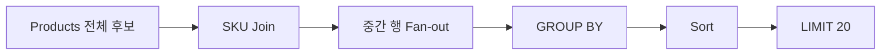
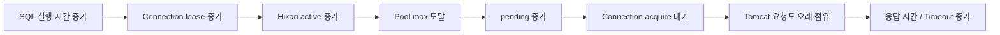

# MySQL 실행 계획과 카디널리티 추정, Page-first 조회

애플리케이션에서 `SELECT ... LIMIT 20`을 사용하면 얼핏 “DB가 20개만 읽겠구나”라고 생각하기 쉽다. 그러나 SQL의 실제 비용은 최종 반환 행 수가 아니라 **그 20개를 만들기 전까지 DB가 어떤 행을 몇 번 읽고, 어떤 조인과 집계·정렬을 거치는가**에 따라 크게 달라진다.

특히 상품 목록처럼 부모 테이블 한 행에 여러 자식 행이 붙고, 자식 상태를 집계한 뒤 정렬·페이지네이션까지 수행하는 쿼리는 데이터가 작을 때는 멀쩡하다가 데이터 규모가 커지면서 갑자기 느려질 수 있다. 이때 필요한 도구가 MySQL의 실행 계획(EXPLAIN)이고, 실행 계획을 읽을 때 핵심이 되는 개념이 **행 수 추정(Cardinality Estimation)**, **선택도(Selectivity)**, **중간 결과 크기**, **임시 테이블**, **정렬**, **LIMIT의 적용 시점**이다.

이 글은 MySQL 실행 계획을 단순히 `type=ALL이면 나쁘다`처럼 외우는 방식이 아니라, **옵티마이저가 어떤 정보를 바탕으로 계획을 선택하고 그 추정이 실제 데이터와 어긋날 때 어떤 문제가 생기는지**, 그리고 부모 목록을 먼저 자른 뒤 자식 관계를 붙이는 Page-first 조회가 언제 유효한지까지 연결해서 설명한다.

기존 문서의 DB 대기·Connection Pool Queueing은 [[06. Tomcat HikariCP DB Queueing]], 데이터 규모·고유도·분포·쏠림은 [[10. 대규모 데이터 Volume Cardinality Distribution Skew]], 작은 변경을 동일 조건에서 재측정하는 원칙은 [[09. Before After와 성능 실험의 인과관계]]와 함께 보면 좋다.

## 1. 실행 계획은 “SQL을 어떤 순서로 처리할지에 대한 DB의 계획”이다

SQL은 선언형 언어다. 개발자는 “무엇을 원하는지”를 작성하지만, 어떤 테이블부터 읽고 어떤 인덱스를 사용하며 어떤 순서로 조인할지는 DB 옵티마이저가 결정한다.

예를 들어 다음 SQL을 보자.

```sql
SELECT p.id, p.name
FROM products p
JOIN categories c ON c.id = p.category_id
WHERE p.status = 'PUBLIC'
  AND c.active = true
ORDER BY p.id DESC
LIMIT 20;
```

개발자가 보는 논리는 단순하다.

```text
공개 상품
→ 활성 카테고리만
→ 최신순
→ 20개
```

하지만 DB가 실제로 고민하는 것은 다르다.

```text
categories부터 읽을까?
products부터 읽을까?
어떤 index를 사용할까?
각 조건을 적용하면 몇 행이 남을까?
정렬 전에 얼마나 많은 행이 만들어질까?
LIMIT 20을 어느 시점에 이용할 수 있을까?
```

MySQL은 비용 기반 옵티마이저(Cost-based Optimizer)를 사용해 여러 후보 계획의 비용을 추정하고 상대적으로 싸다고 판단한 계획을 선택한다. 따라서 느린 SQL을 볼 때는 문장만 보는 것이 아니라 **옵티마이저가 실제로 선택한 접근 경로와 그 판단의 근거가 된 추정치**를 확인해야 한다.

MySQL 공식 문서도 `EXPLAIN`을 “MySQL이 문장을 어떻게 실행할지, 테이블을 어떤 순서로 조인할지 보여 주는 도구”로 설명한다.

- [MySQL 8.4 Reference Manual - Optimizing Queries with EXPLAIN](https://dev.mysql.com/doc/refman/8.4/en/using-explain.html)
- [MySQL 8.4 Reference Manual - EXPLAIN Statement](https://dev.mysql.com/doc/refman/8.4/en/explain.html)

LINE Engineering의 Visual EXPLAIN 사례는 실행 계획을 도식으로 보면서 Full Scan, Index Lookup, `tmp table`, 정렬이 어디에서 생기는지 비교한다. 오래된 MySQL 버전을 기준으로 한 글이므로 세부 비용 모델을 그대로 적용하면 안 되지만, **실행 계획에서 데이터 접근 방식과 중간 연산을 읽는 사고방식**은 여전히 유용하다.

- [LINE Engineering - MySQL Workbench의 VISUAL EXPLAIN으로 인덱스 동작 확인하기](https://engineering.linecorp.com/ko/blog/mysql-workbench-visual-explain-index/)

## 2. EXPLAIN TREE, JSON, ANALYZE는 목적이 다르다

MySQL 8 계열에서는 같은 실행 계획도 여러 형식으로 볼 수 있다.

`EXPLAIN FORMAT=TREE`는 실행 연산을 트리 형태로 보여 준다. Nested Loop, Hash Join, Sort, Aggregate, Limit 같은 연산이 계층으로 표현되므로 **데이터가 어느 연산을 거쳐 위로 올라가는지** 읽기 좋다.

```text
-> Limit: 20
    -> Sort: id DESC
        -> Aggregate using temporary table
            -> Nested loop left join
                -> ...
```

이 트리는 보통 **안쪽에서 바깥쪽, 아래에서 위**로 읽는다. 가장 안쪽에서 어떤 테이블을 읽고, 그 결과가 조인을 거쳐 몇 행으로 늘어나며, 이후 집계와 정렬을 거쳐 최종 LIMIT에 도달하는지를 본다.

`EXPLAIN FORMAT=JSON`은 같은 계획을 더 구조적인 필드로 보여 준다. 버전에 따라 필드명은 조금 다를 수 있지만 `estimated_rows`, `rows_examined_per_scan`, `rows_produced_per_join`, `key`, `key_columns`, `cost_info` 같은 정보를 이용해 **옵티마이저가 각 단계의 행 수와 비용을 어떻게 추정했는지** 확인하기 좋다.

반면 `EXPLAIN ANALYZE`는 성격이 다르다. 이름에 EXPLAIN이 들어가지만 **실제로 SELECT를 실행한다.** MySQL 공식 문서에 따르면 각 iterator의 예상 행 수뿐 아니라 실제 행 수, 반복 횟수, 첫 행까지 걸린 시간, 실제 실행 시간을 함께 보여 준다.

```text
예상
cost=...
rows=...

실제
actual time=...
rows=...
loops=...
```

따라서 운영 DB나 이미 비싼 것으로 의심되는 SQL에서 `EXPLAIN ANALYZE`를 “읽기 전용이니까 안전하다”고 가볍게 실행하면 안 된다. 데이터 변경은 하지 않더라도 **비싼 SELECT 자체를 수행해 CPU·I/O·Connection을 점유할 수 있기 때문**이다.

진단 순서는 보통 다음처럼 안전하게 가져간다.

```text
EXPLAIN TREE
→ 계획의 큰 모양 확인
→ EXPLAIN JSON
→ 추정 행 수·인덱스·비용 확인
→ 실제 데이터 분포와 대조
→ 필요성과 실행 안전성이 확보된 경우에만 EXPLAIN ANALYZE
```

## 3. 카디널리티라는 말은 문맥에 따라 뜻이 다르다

DB 성능에서 `Cardinality`는 한 가지 의미로만 사용되지 않는다. 이 차이를 구분하지 않으면 실행 계획을 읽을 때 혼란이 생긴다.

### 데이터 고유도

컬럼 카디널리티라고 할 때는 보통 **서로 다른 값의 개수**를 뜻한다.

```text
status = {PUBLIC, PRIVATE}
→ 고유값 수 2

user_id = 거의 모든 행이 서로 다름
→ 높은 고유도
```

이 개념은 [[10. 대규모 데이터 Volume Cardinality Distribution Skew]]에서 자세히 설명한다.

### SHOW INDEX의 Cardinality

`SHOW INDEX FROM table`의 `Cardinality`는 해당 인덱스 키 또는 인덱스 prefix의 **고유값 수에 대한 추정치**다. InnoDB 통계는 근사치일 수 있으므로 실제 `COUNT(DISTINCT ...)`와 정확히 같다고 기대하면 안 된다.

예를 들어 10만 행에서 `category_id`의 `Cardinality`가 5라면, 단순한 균등 분포 가정에서는 category 하나당 약 2만 행이 있을 것으로 볼 수 있다.

### 실행 계획의 행 수 추정

실행 계획에서 `rows=20000`, `estimated_rows=350`처럼 나오는 값은 또 다른 의미다. 이는 **그 연산에서 몇 행을 읽거나 다음 단계로 보낼 것이라고 옵티마이저가 예상했는지**를 나타낸다.

따라서 다음 세 가지는 서로 연결되지만 같은 값은 아니다.

```text
컬럼의 고유값 수
→ 조건의 선택도 추정에 영향

인덱스 통계
→ 접근 경로 비용 추정에 영향

operator의 estimated rows
→ 조인 순서·집계·정렬 비용 판단에 영향
```

## 4. 선택도는 “이 조건이 얼마나 많이 걸러 주는가”다

선택도(Selectivity)는 조건을 적용했을 때 전체 행 중 얼마나 적은 행만 남는지를 표현하는 관점이다.

예를 들어 100만 행에서 다음 조건을 비교해 보자.

```text
WHERE id = 123
→ 거의 1행
→ 매우 강하게 줄임

WHERE status = 'ACTIVE'
→ 95만 행
→ 거의 줄이지 못함
```

두 조건 모두 인덱스를 만들 수는 있지만, 인덱스가 존재한다는 사실만으로 효율성이 결정되는 것은 아니다. DB는 **이 조건으로 실제 후보가 얼마나 줄어드는가**, 이후 정렬·조인에 어떤 이점이 있는가를 함께 본다.

특히 실제 데이터가 심하게 치우쳐 있으면 고유값 수만으로는 분포를 제대로 알 수 없다.

```text
status 종류 = 2개

ACTIVE   99%
INACTIVE 1%
```

“두 값이 있으니 각각 50%쯤이겠지”라는 가정은 크게 틀린다. 이런 분포 차이는 조인 순서와 인덱스 선택 비용을 잘못 추정하게 만들 수 있다.

## 5. 히스토그램은 고유값 수보다 더 구체적인 값 분포 정보를 준다

MySQL은 `INFORMATION_SCHEMA.COLUMN_STATISTICS`를 통해 컬럼 히스토그램 정보를 노출한다. 공식 문서에 따르면 히스토그램은 값의 분포를 bucket 형태로 저장하고, 옵티마이저가 `column = constant`, 범위 비교, `IN`, `BETWEEN` 같은 조건의 선택도를 추정할 때 활용할 수 있다.

- [MySQL 8.4 - Optimizer Statistics](https://dev.mysql.com/doc/refman/8.4/en/optimizer-statistics.html)
- [MySQL 8.4 - INFORMATION_SCHEMA COLUMN_STATISTICS](https://dev.mysql.com/doc/refman/8.4/en/information-schema-column-statistics-table.html)

예를 들어 다음 데이터가 있다고 하자.

```text
전체 100,000행
status = 'PUBLIC' 100,000행
```

그런데 옵티마이저가 이 분포를 충분히 알지 못해 `PUBLIC` 조건 뒤에 10%만 남을 것으로 추정한다면:

```text
실제     100,000
예상      10,000
```

이 오차는 다음 조인에서 다시 곱해질 수 있다. 부모 한 행당 자식이 평균 3개라면:

```text
실제 중간 결과 300,000행
예상 중간 결과  30,000행
```

이렇게 행 수 추정이 누적해서 어긋나면 옵티마이저가 실제로는 비싼 계획을 싸다고 판단할 수 있다.

다만 **히스토그램이 없다고 해서 곧바로 히스토그램을 만들어야 한다는 뜻은 아니다.** 통계 보정은 DB 상태를 변경하는 작업이고, 쿼리 구조 자체가 불필요하게 많은 행을 처리하는 문제라면 통계를 정교하게 만들어도 근본 작업량은 남는다.

MySQL에서는 `ANALYZE TABLE ... UPDATE HISTOGRAM`으로 히스토그램을 관리할 수 있지만, 먼저 현재 실행 계획과 실제 데이터 분포를 비교해 “통계 오차가 계획 선택을 실제로 잘못 이끌고 있는가”를 확인하는 편이 좋다.

- [MySQL 8.4 - ANALYZE TABLE Statement](https://dev.mysql.com/doc/refman/8.4/en/analyze-table.html)

## 6. 조인은 최종 행보다 훨씬 큰 중간 결과를 만들 수 있다

부모-자식 관계에서 목록 SQL이 느려지는 대표적인 이유가 **Fan-out**이다.

```text
Product 100,000개
평균 SKU 3개

Product LEFT JOIN SKU
→ 최대 약 300,000개의 중간 행
```

사용자는 상품 20개만 요청했더라도 SQL 구조가 다음과 같다면 DB는 많은 중간 행을 먼저 만들 수 있다.

```sql
SELECT p.id,
       MAX(CASE WHEN s.active THEN 1 ELSE 0 END)
FROM products p
LEFT JOIN skus s ON s.product_id = p.id
GROUP BY p.id
ORDER BY p.id DESC
LIMIT 20;
```

여기서 중요한 것은 SQL에 `LIMIT 20`이 존재한다는 사실이 아니라 **LIMIT이 논리적으로 어느 연산 뒤에 적용되는가**다.



`GROUP BY` 결과를 만들어야 최종 한 상품당 한 행이 되고, 정렬 기준도 그 이후에 결정된다면 MySQL은 처음부터 20개 Product만 읽고 끝낼 수 없다.

따라서 성능 분석에서는 **최종 반환 20행보다 LIMIT 직전까지 몇 행이 흘러가는가**가 더 중요한 질문이 된다.

## 7. 임시 테이블과 정렬은 “존재 여부”보다 “들어가는 데이터 양”을 본다

실행 계획에 다음 문구가 나오면 흔히 바로 문제라고 생각한다.

```text
Aggregate using temporary table
Table scan on <temporary>
Sort
```

하지만 임시 테이블(Internal Temporary Table)이나 정렬 자체가 무조건 나쁜 것은 아니다. GROUP BY, DISTINCT, ORDER BY 같은 요구를 만족하려면 필요한 경우가 있다.

진짜 중요한 것은 다음이다.

```text
임시 테이블에 40행이 들어가는가?
20만 행이 들어가는가?

정렬 대상이 20행인가?
수십만 행인가?
```

MySQL 공식 문서는 ORDER BY와 GROUP BY가 서로 다른 테이블 컬럼을 포함하는 등의 상황에서 임시 테이블이 사용될 수 있다고 설명한다.

- [MySQL 8.4 - WHERE Clause Optimization](https://dev.mysql.com/doc/refman/8.4/en/where-optimization.html)
- [MySQL 8.4 - Optimizing SELECT Statements](https://dev.mysql.com/doc/refman/8.4/en/select-optimization.html)

LINE의 Visual EXPLAIN 사례에서도 GROUP BY 앞의 `tmp table`과 정렬을 실행 계획으로 확인하고 인덱스 적용 전후를 비교한다. 여기서 배울 점은 “tmp table을 무조건 제거한다”가 아니라 **왜 만들어졌고 몇 행을 대상으로 하는지 확인한 뒤 가장 큰 작업량을 먼저 줄이는 것**이다.

## 8. LIMIT 20은 앞단의 큰 집계를 자동으로 없애 주지 않는다

MySQL은 `ORDER BY ... LIMIT N`을 알고 있으면 정렬 과정에서 상위 N개만 유지하는 최적화를 적용할 수 있다. 실행 계획에 다음과 비슷한 표현이 보일 수 있다.

```text
Sort: ..., limit input to 20 row(s) per chunk
```

이것은 정렬 메모리를 줄이는 데 도움을 줄 수 있지만, **정렬에 들어오기 전에 수행한 Join·GROUP BY의 작업까지 20행으로 줄였다는 뜻은 아니다.**

따라서 다음 두 쿼리는 최종 반환 행 수는 같아도 작업량이 매우 다를 수 있다.

```text
A
100,000 Product
→ 300,000 child join rows
→ GROUP BY
→ sort
→ LIMIT 20

B
Product에서 먼저 20개 선택
→ 약 60 child rows
→ GROUP BY
```

성능 튜닝에서는 이 차이를 “LIMIT이 있느냐”보다 **LIMIT을 얼마나 앞쪽으로 안전하게 이동시킬 수 있느냐**의 문제로 본다.

## 9. Page-first 조회는 부모 페이지를 먼저 고른 뒤 자식 관계를 붙인다

Page-first는 ORM이나 MySQL의 공식 기능 이름이라기보다, 목록 조회를 설계하는 실용적인 패턴을 설명하기 위한 표현이다.

핵심은 다음과 같다.

```text
필터와 정렬로 부모 Entity의 page 결정
→ LIMIT/OFFSET
→ 그 부모들에 대해서만 child Join / Aggregate / Projection
```

예를 들어 최신 게시물 20개를 가져오고 댓글 존재 여부를 계산한다고 하자.

```sql
SELECT base.id,
       MAX(c.id IS NOT NULL) AS has_comment
FROM (
    SELECT p.id
    FROM posts p
    WHERE p.status = 'PUBLIC'
    ORDER BY p.id DESC
    LIMIT 20
) base
LEFT JOIN comments c ON c.post_id = base.id
GROUP BY base.id
ORDER BY base.id DESC;
```

여기서 내부 derived table의 `LIMIT`은 중요한 의미를 가진다. MySQL 공식 문서에 따르면 `LIMIT`은 derived table을 outer query와 merge하지 못하게 하는 구성 요소 중 하나다. 따라서 이 형태에서는 page 결과가 별도 materialization 대상이 될 수 있고, outer join은 그 작은 결과를 입력으로 받는다.

- [MySQL 8.4 - Derived Table Optimization](https://dev.mysql.com/doc/refman/8.4/en/derived-table-optimization.html)

이 구조의 목표는 임시 테이블을 “0개”로 만드는 것이 아니다. 오히려 작은 page를 materialize하더라도 **비싼 child fan-out과 aggregate의 입력 크기를 제한하는 것**이 목적이다.

## 10. Page-first는 모든 정렬에서 안전하지 않다

가장 중요한 주의점이다.

다음 정렬은 부모 테이블만 보고 결정할 수 있다.

```text
ORDER BY product.id DESC
ORDER BY product.created_at DESC
```

이런 경우 필터 조건도 부모 또는 `EXISTS`로 미리 평가 가능하다면 먼저 page를 자르는 것이 비교적 자연스럽다.

하지만 다음 정렬은 다르다.

```text
가장 싼 SKU 가격순
평균 리뷰 점수순
리뷰 개수순
재고 합계순
```

이 값들은 child row를 읽고 집계하거나 대표값을 계산해야 결정된다. 먼저 임의의 Product 20개를 고른 뒤 가격을 계산하면 **전체 후보 중 진짜 가격 상위/하위 20개가 아닌 결과**가 된다.

따라서 Page-first를 적용하려면 최소한 다음을 확인해야 한다.

```text
1. WHERE 조건을 page 선택 전에 동일하게 평가할 수 있는가
2. ORDER BY 값이 page 선택 전에 결정 가능한가
3. LIMIT/OFFSET을 이동해도 결과 집합의 의미가 같은가
4. 최종 projection만 outer 단계로 미뤄도 되는가
```

성능 개선은 결과 의미를 바꾸면 실패다. “더 빠르지만 다른 20개를 반환하는 SQL”은 최적화가 아니다.

## 11. dependent subquery는 outer row 수와 함께 본다

목록 Projection에서 다음처럼 대표 자식 하나를 고르는 scalar subquery가 자주 사용된다.

```sql
SELECT p.id,
       (
           SELECT s.price
           FROM skus s
           WHERE s.product_id = p.id
           ORDER BY s.price, s.id
           LIMIT 1
       ) AS representative_price
FROM products p;
```

실행 계획에 `dependent`가 표시되면 이 subquery는 바깥 행의 값에 의존한다. 그래서 outer row가 많으면 반복 평가 횟수도 문제가 될 수 있다.

그러나 `dependent subquery = 무조건 제거`로 판단하면 안 된다.

```text
outer row 100,000개
→ dependent lookup 반복 위험 큼

outer row 20개
→ 같은 lookup이라도 전체 비용은 훨씬 작을 수 있음
```

따라서 먼저 **큰 outer 결과를 줄이는 구조적 개선**이 가능한지 보고, 그 뒤에도 병목이 남으면 대표 자식 조회를 JOIN, Window Function, 별도 pre-aggregation 등으로 통합할지 검토하는 순서가 합리적이다.

## 12. FORCE INDEX와 STRAIGHT_JOIN은 진단 도구로도 사용할 수 있다

옵티마이저가 특정 인덱스나 조인 순서를 선택하지 않을 때 `FORCE INDEX`, `STRAIGHT_JOIN` 같은 힌트를 이용해 “다른 계획이라면 모양이 어떻게 바뀌는가”를 확인할 수 있다.

예를 들어 최신 ID 순서로 20개가 필요한 쿼리에서 다음 진단을 해볼 수 있다.

```sql
EXPLAIN FORMAT=TREE
SELECT p.id
FROM products p FORCE INDEX (PRIMARY)
WHERE ...
ORDER BY p.id DESC
LIMIT 20;
```

계획이 다음처럼 바뀐다면 중요한 단서다.

```text
Index scan PRIMARY reverse
→ Filter
→ LIMIT 20
```

하지만 이것을 바로 운영 코드에 넣는 것은 별개 문제다.

MySQL 공식 문서도 인덱스 힌트와 `STRAIGHT_JOIN`을 옵티마이저 제어 수단으로 제공하지만, 힌트는 데이터 분포나 조건이 달라졌을 때 더 나쁜 계획을 강제할 수 있다. `STRAIGHT_JOIN`은 일부 semijoin 변환을 막을 수 있다는 주의도 있다.

- [MySQL 8.4 - Optimizer-Related Issues](https://dev.mysql.com/doc/refman/8.4/en/optimizer-issues.html)
- [MySQL 8.4 - Optimizing Queries with EXPLAIN](https://dev.mysql.com/doc/refman/8.4/en/using-explain.html)

그래서 다음 순서가 더 안전하다.

```text
힌트로 counterfactual plan 확인
→ 왜 원래 optimizer가 다른 계획을 골랐는지 확인
→ SQL 구조만으로 작업량을 줄일 수 있는지 먼저 검토
→ 그래도 필요할 때 통계 / index / hint를 각각 독립적으로 검증
```

## 13. 느린 SQL은 Connection Pool 문제로 증폭될 수 있다

SQL 하나가 50ms에서 5초로 느려지면 문제는 “그 요청 하나가 5초 걸린다”에서 끝나지 않는다.

JDBC 기반 Spring 애플리케이션은 SQL이 실행되는 동안 DB Connection을 점유한다. 요청률이 유지되는데 Connection 반환이 늦어지면 동시에 사용 중인 Connection 수가 증가한다.



HikariCP 공식 설정 문서에 따르면 `maximumPoolSize`에 도달하고 idle connection이 없으면 `getConnection()` 호출은 `connectionTimeout`까지 기다린 뒤 실패한다. 기본 설정 기준으로 `maximumPoolSize`는 10, `connectionTimeout`은 30초다. 실제 애플리케이션 값은 별도 설정으로 달라질 수 있으므로 운영 값은 직접 확인해야 한다.

- [HikariCP - Configuration](https://github.com/brettwooldridge/HikariCP#frequently-used)
- [HikariCP - About Pool Sizing](https://github.com/brettwooldridge/HikariCP/wiki/About-Pool-Sizing)

여기서 흔한 오해가 “pending이 생겼으니 Pool을 늘리자”다. Pool을 늘리면 일시적으로 대기 요청을 더 많이 DB로 밀어 넣을 수 있지만, 근본 원인이 긴 SQL이라면 DB 동시 작업량만 늘려 더 큰 지연을 만들 수도 있다.

따라서 [[06. Tomcat HikariCP DB Queueing]]에서 설명한 것처럼 `pending`은 원인이라기보다 **뒤쪽 작업이 Connection을 충분히 빨리 반환하지 못하고 있다는 결과 신호**로 읽는 편이 안전하다.

## 14. 실행 계획을 이용한 성능 진단의 실전 순서

복잡한 목록 쿼리가 데이터 증가 뒤 느려졌다면 다음 순서가 재현성이 좋다.

```text
1. 사용자 결과 확인
   latency / timeout / throughput / error

2. Connection lifecycle 확인
   acquire / lease / repository 구간

3. 비싼 SQL 후보 분리
   count vs list vs detail 등

4. EXPLAIN TREE
   join → aggregate → sort → limit 큰 흐름 확인

5. 실제 데이터 분포 확인
   COUNT / GROUP BY / fan-out

6. SHOW INDEX / 통계 확인
   index key, cardinality, histogram

7. EXPLAIN JSON과 actual distribution 대조
   estimated rows가 어디서 벌어지는지 확인

8. counterfactual plan
   subquery 제거 / page-first / index hint 등

9. 가장 작은 변경 하나 선택

10. 동일 Source / Dataset / Workload로 재측정
```

이 흐름의 핵심은 “EXPLAIN에서 빨간 부분을 찾아 인덱스를 추가한다”가 아니다. **실제 사용자 지연에서 시작해 Connection 점유 구간과 SQL 작업량을 연결하고, 가장 큰 중간 결과를 줄일 수 있는 최소 변경을 찾는 것**이다.

## 15. 정리

MySQL 실행 계획을 제대로 읽으려면 인덱스 이름보다 **데이터 흐름**을 먼저 봐야 한다.

```text
어디에서 몇 행을 읽는가
→ 조건 뒤 몇 행이 남는다고 예상하는가
→ 조인으로 몇 행이 늘어나는가
→ 집계·정렬 전에 중간 결과가 얼마나 큰가
→ LIMIT은 언제 적용되는가
```

옵티마이저의 추정 행 수는 실제 행 수가 아니다. 통계와 값 분포가 부족하면 큰 오차가 생길 수 있고, 그 오차는 여러 조인을 지나면서 증폭될 수 있다. 그렇다고 통계나 인덱스를 곧바로 수정할 필요는 없다. SQL 구조가 원래부터 큰 중간 결과를 만든다면 **처리해야 하는 행 자체를 줄이는 구조적 변경**이 더 작은 해결책일 수 있다.

Page-first 조회는 그 대표적인 방법 중 하나다. 부모 Entity의 필터와 정렬 의미를 보존할 수 있을 때 먼저 페이지를 결정한 뒤 자식 관계를 붙이면, 최종 20행을 얻기 위해 수십만 행을 집계하는 구조를 수십 행 수준으로 줄일 수 있다.

하지만 가격·평점·리뷰 수처럼 자식 계산 결과로 순위를 정하는 경우에는 먼저 페이지를 자르면 결과가 달라진다. 따라서 성능 개선의 기준은 언제나 같다.

> **더 빠른 SQL이 아니라, 같은 의미를 더 적은 작업으로 수행하는 SQL을 만든다.**

## 참고 자료

본문에서 사용한 핵심 자료다. 링크만 훑기보다 각 문서의 EXPLAIN 형식, optimizer statistics, derived table merge/materialization, pool saturation 설명을 함께 보는 것을 권장한다.

- [MySQL 8.4 - EXPLAIN Statement](https://dev.mysql.com/doc/refman/8.4/en/explain.html)
- [MySQL 8.4 - Optimizing Queries with EXPLAIN](https://dev.mysql.com/doc/refman/8.4/en/using-explain.html)
- [MySQL 8.4 - Optimizer Statistics](https://dev.mysql.com/doc/refman/8.4/en/optimizer-statistics.html)
- [MySQL 8.4 - ANALYZE TABLE](https://dev.mysql.com/doc/refman/8.4/en/analyze-table.html)
- [MySQL 8.4 - Derived Table Optimization](https://dev.mysql.com/doc/refman/8.4/en/derived-table-optimization.html)
- [MySQL 8.4 - Optimizer-Related Issues](https://dev.mysql.com/doc/refman/8.4/en/optimizer-issues.html)
- [LINE Engineering - MySQL Workbench의 VISUAL EXPLAIN으로 인덱스 동작 확인하기](https://engineering.linecorp.com/ko/blog/mysql-workbench-visual-explain-index/)
- [HikariCP - Configuration](https://github.com/brettwooldridge/HikariCP#frequently-used)
- [HikariCP - About Pool Sizing](https://github.com/brettwooldridge/HikariCP/wiki/About-Pool-Sizing)
